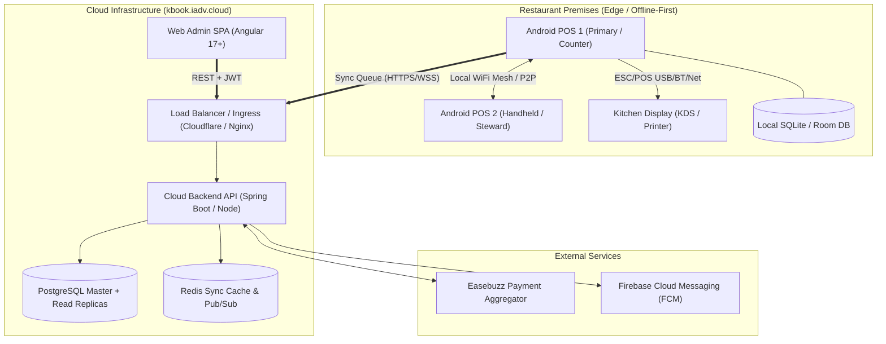

# KhanaBook — System Architecture Specification (ARCHITECTURE.md)

**Document Version:** 2.0.0  
**Status:** Approved Source of Truth for System Architecture  
**Target:** Monorepo (`apps/web-admin`, `apps/android`, `services/*`)  

---

## 1. High-Level System Architecture

KhanaBook utilizes a **hybrid offline-first edge architecture** paired with a cloud-native synchronization and analytics backend.



---

## 2. Technology Stack & Technical Rationale

| Layer / Component | Technology | Rationale |
| :--- | :--- | :--- |
| **Web Admin Frontend** | Angular 17+ (TypeScript, SCSS, ESBuild) | Type-safe, modular enterprise architecture; reactive forms for deep settings; built-in dependency injection for maintainable service contracts. |
| **Android POS Client** | Kotlin, Jetpack Compose, Room DB | Native performance; sub-second UI responsiveness; direct hardware integration for USB/BT thermal printers and payment PIN pads. |
| **Cloud Backend** | Spring Boot (Java 21) & Node.js microservices | Robust transactional integrity for financial settlements; high throughput for concurrent terminal sync queues. |
| **Database** | PostgreSQL 16+ (Cloud) & SQLite 3 (Edge) | PostgreSQL provides ACID guarantees and robust JSONB support for order item snapshots; SQLite delivers zero-dependency local offline storage. |
| **Payment Gateway** | Easebuzz Sub-Merchant API | Certified RBI payment aggregator providing automated sub-merchant onboarding and instant dynamic UPI QR checkout. |
| **Push & Notifications** | Firebase Cloud Messaging (FCM) | Lightweight real-time invalidation pings to edge terminals when menu prices or availability change in Web Admin. |

---

## 3. Data Flow & Synchronization Contract

### 3.1 Offline-First Event Sourcing
1. **Local Commit First:** Every order creation, item addition, payment collection, or bill void is written immediately to the local Android SQLite database with an autoincrementing local event ID and UTC timestamp.
2. **Bill Number Sequencing:** Bill numbers follow the format `KB-{RestaurantId}-{TerminalId}-{ShiftNumber}-{Seq}` to eliminate collision across offline terminals without waiting for cloud coordination.
3. **Outbox Pattern:** Written events are queued in a persistent local Outbox table (`sync_outbox`).
4. **Batch Synchronization:** When network connectivity is active, the Sync Worker posts batches (up to 50 events) to `/api/v1/sync/events`.
5. **Conflict Resolution:** Cloud uses **Last-Write-Wins (LWW) with Monotonic Clock Validation**. For financial transactions (payments), events are strictly append-only; voided orders append a negative compensation ledger record.

---

## 4. Repository & Monorepo Folder Structure

```
KhanaBook/
├── apps/
│   ├── web-admin/               # Angular Web Admin SPA
│   │   ├── src/
│   │   │   ├── app/
│   │   │   │   ├── core/        # Auth, guards, interceptors, API models
│   │   │   │   ├── layout/      # Sidebar, headers, bottom action bars
│   │   │   │   ├── pages/       # Dashboard, Menu, Orders, Staff, Settings
│   │   │   │   └── shared/      # Modals, buttons, badges, tables
│   │   │   └── styles/          # Global tokens, themes, reset
│   │   └── angular.json
│   └── android/                 # Kotlin Jetpack Compose POS App
│       ├── app/
│       │   ├── src/main/java/com/khanabook/
│       │   │   ├── data/        # Room DB, entities, sync worker
│       │   │   ├── domain/      # Order use cases, printing, billing
│       │   │   └── presentation/# Compose screens, POS floor, cashier
│       └── build.gradle.kts
├── services/                    # Cloud backend services & API gateways
│   ├── core-api/                # Authentication, business, menu, staff
│   ├── sync-service/            # Terminal event ingestion & queue
│   └── payment-service/         # Easebuzz webhook handler & reconciler
├── docs/                        # Architecture, specs, PRD, design tokens
└── specs/                       # Test specifications and fixtures
```

---

## 5. Authentication, Authorization & Security Boundaries

### 5.1 Authentication Flow
* **Stateless JWT:** Upon successful login with phone/email and password/OTP, the server issues a signed HMAC-SHA512 JWT (valid for 180 days with refresh token rotation).
* **Storage Isolation:** On Web Admin, the session token is preserved in `window.sessionStorage` under `khanabook.webAdmin.v1.session` to protect against cross-tab token pollution and automatically clear upon browser window termination.
* **Header Transmission:** All client requests pass `Authorization: Bearer <token>`.

### 5.2 Role-Based Access Control (RBAC) Matrix

| Resource / Action | `OWNER` | `MANAGER` | `CASHIER` | `KITCHEN` |
| :--- | :---: | :---: | :---: | :---: |
| View Financial Reports & GST | Full | View Only | Denied | Denied |
| Modify Menu Items & Prices | Full | View Only | View Only | View Only |
| Toggle Dish Availability | Full | Full | View Only | Mark Out |
| Manage Staff & Permissions | Full | Denied | Denied | Denied |
| Bill Orders & Accept Payments| Full | Full | Full | Denied |
| Void Bills & Apply Discounts | Full | Full (Limit) | Supervisor Req | Denied |
| View KOT Kitchen Tickets | Full | Full | Full | Full |

### 5.3 Security Boundaries & Tenancy Isolation
* **Tenant Scoping:** Every SQL query and API invocation MUST filter by `restaurant_id` extracted exclusively from the validated JWT claims. Clients cannot inject arbitrary `restaurant_id` query parameters.
* **Secret Protection:** API secret keys for Easebuzz and database credentials reside strictly in cloud environment variables (`.env`) and NEVER compile into frontend bundles.

---

## 6. Error Handling Strategy

1. **Client-Side Graceful Degradation:**
   * When an API request fails due to network dropout, the Web Admin renders inline retry affordances and cached read-only views without throwing unhandled exceptions.
2. **Standard Error Envelope:**
   All backend JSON error responses follow a uniform contract:
   ```json
   {
     "success": false,
     "error": {
       "code": "ITEM_ALREADY_EXISTS",
       "message": "A dish with this name already exists in this category.",
       "details": {}
     }
   }
   ```
3. **404 Route Fallback:** Unmapped URLs gracefully render the branded KOT Void 404 ticket (`ERR-404-VOID`) rather than crashing or showing blank white pages.

---

## 7. Testing & Quality Assurance Architecture

* **Unit & Component Tests:** Jasmine & Karma across Angular Web Admin (`npm test`), testing components, interceptors, and utility functions (207+ passing tests).
* **End-to-End & Live Auditing:** Playwright test suites executing automated UI/UX, responsive, and accessibility audits across 1440×900 and 375×812 viewports.
* **Android Unit & Room Tests:** JUnit 5, Mockk, and Room in-memory database testing verifying sync collision logic.
