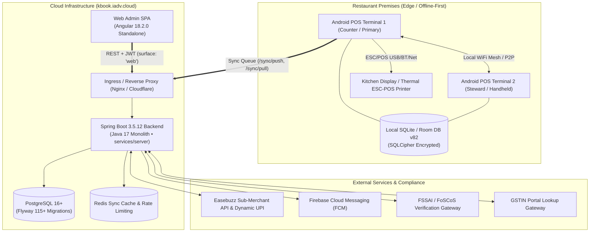

# KhanaBook — System Architecture Specification (ARCHITECTURE.md)

**Document Version:** 2.1.0  
**Status:** Approved Source of Truth for System Architecture (Verified against Codebase Ground Truth)  
**Target Monorepo:** `apps/web-admin` (Angular 18.2.0), `apps/android` (Kotlin Compose, Room v82), `services/server` (Spring Boot 3.5.12, Java 17)  

---

## 1. High-Level System Architecture

KhanaBook operates on a **hybrid offline-first edge architecture** paired with a cloud-native synchronization and analytics backend.



---

## 2. Technology Stack & Technical Rationale

| Layer / Component | Technology | Codebase Ground Truth | Technical Rationale |
| :--- | :--- | :--- | :--- |
| **Web Admin Frontend** | Angular 18.2.0 Standalone | `apps/web-admin` (TypeScript, SCSS, ESBuild, Signals, RxJS) | Type-safe, modular enterprise architecture; standalone components with zero NgModules; Angular Signals for fine-grained reactive state; WCAG 2.1 AA compliant. |
| **Android POS Client** | Kotlin, Jetpack Compose | `apps/android` (Room schema v82, SQLCipher, Dagger Hilt, WorkManager) | Native edge performance; sub-second offline billing; SQLCipher database encryption per restaurant (`khanabook_lite_db_<restaurantId>`); direct ESC/POS hardware printing. |
| **Cloud Backend** | Spring Boot 3.5.12 on Java 17 | `services/server` (Maven monolith, Spring Data JPA, Hibernate 6) | Strong ACID transactional integrity for financial ledgers; structured monolithic architecture partitioned by domain feature packages (`billing`, `inventory`, `menu`, `auth`, `sync`, `payments`, `compliance`). |
| **Cloud Database** | PostgreSQL 16+ | 115+ Flyway migrations (`V1` through `V115`) | Relational integrity, composite unique constraints (`restaurant_id`, `device_id`, `local_id`), JSONB support, tenant-isolated data structures. |
| **Edge Database** | SQLite 3 / Room v82 | 17 Room entities (`AppDatabase.kt`) | Local zero-latency reads/writes, transactional outbox pattern, SQLCipher encryption at rest. |
| **Payment Gateway** | Easebuzz Sub-Merchant API | Webhook HMAC-SHA512 verification | Certified RBI payment aggregator providing automated sub-merchant KYC onboarding, split payments, and instant dynamic UPI QR checkout. |
| **Push Invalidation** | Firebase Cloud Messaging (FCM) | `DeviceToken`, `NotificationEvent` | Lightweight real-time invalidation pings to edge terminals when menu prices, item availability, or permissions change. |

---

## 3. Multi-Tenant Sync & Data Flow Contract

### 3.1 Composite Key Contract (`BaseSyncEntity`)
Every edge-synced entity inherits from `BaseSyncEntity` and adheres to a strict composite tuple:
* **Tuple:** `(restaurant_id, device_id, local_id)`
* **Invariants:**
  * `restaurant_id`: Tenant boundary (BigInt).
  * `device_id`: Hardware identifier of the creating POS device (String).
  * `local_id`: Locally autoincrementing primary key generated in SQLite (BigInt).
  * `version`: Optimistic lock counter (`@Version`).
  * `server_updated_at`: Epoch timestamp (millis) stamped by the server on write.
  * `is_deleted`: Soft-delete flag; records are never physically destroyed.

### 3.2 Offline-First Sync Cycle
1. **Local Commit First:** Billing, menu status changes, and raw material usages commit immediately to the local Room database (`khanabook_lite_db_<restaurantId>`).
2. **Bill Invoice Number Generation:** Bill numbers follow the format `KB-{RestaurantId}-{TerminalSeries}-{FinancialYear}-{Seq}`. Sequence allocation is gated by `RestaurantTerminal.terminalSeries` to prevent number collisions across offline terminals.
3. **Push Sync (`POST /sync/push`):**
   * Android WorkManager batches un-synced entities and pushes them to the server.
   * Server validates `restaurant_id` against the JWT claims.
   * Protects deliberate status changes using `status_version` monotonic counters (preventing stale Last-Write-Wins overwrites).
4. **Pull Sync (`POST /sync/pull`):**
   * Android terminal requests all records where `server_updated_at > last_sync_timestamp`.
   * Delta updates are merged into Room in a single local transaction.

---

## 4. Role-Based Access Control (RBAC) Architecture

Per migration `V94__collapse_staff_roles`, KhanaBook enforces a 3-role security model:

```mermaid
flowchart LR
    subgraph Roles["Role Hierarchy"]
        Admin["KBOOK_ADMIN\n(Superadmin / Platform)"]
        Owner["OWNER\n(Restaurant Proprietor)"]
        Staff["SHOP_STAFF\n(Cashier / Steward / Counter)"]
    end

    subgraph Surfaces["Client Access Boundaries"]
        Web["Web Admin (https://kbook.iadv.cloud)"]
        POS["Android POS App"]
    end

    Admin --> |Full Platform Access| Web
    Owner --> |Full Business Access| Web
    Owner --> |Full Business Access| POS
    Staff --> |POS Billing & Counter ONLY| POS
    Staff -.-> |REJECTED (surface: 'web')| Web
```

### Role Security Matrix

| Role | Web Admin Access | POS App Access | Permissions & Capabilities |
| :--- | :---: | :---: | :--- |
| **`OWNER`** | **YES** | **YES** | Full control: Menu pricing, business profiles, GST/FSSAI settings, staff creation, terminal approval, inventory recipes, manual refunds, and daily closing. |
| **`SHOP_STAFF`** | **NO (Blocked)** | **YES** | POS counter billing only: Order creation, KOT generation, split payments, table assignment. **Explicitly rejected at `/auth/login` when `surface: 'web'`.** |
| **`KBOOK_ADMIN`** | **YES** | **NO** | Internal platform operations: Feature flag toggles, merchant onboarding audits, system health monitoring. |

---

## 5. Monorepo Repository Structure

```
KhanaBook/
├── apps/
│   ├── web-admin/               # Angular 18.2.0 Standalone Web Admin SPA
│   │   ├── src/app/
│   │   │   ├── core/            # Auth, guards, interceptors, business-api.service.ts
│   │   │   ├── layout/          # Sidebar, header, navigation shell
│   │   │   ├── pages/           # Dashboard, Menu, Orders, Staff, Terminals, Inventory, Settings
│   │   │   └── shared/          # Reusable modal, badges, data tables, buttons
│   │   ├── angular.json
│   │   └── package.json         # Angular 18.2.0, fast-check, animejs, qrcode
│   └── android/                 # Kotlin Jetpack Compose Android POS App
│       ├── app/src/main/java/com/khanabook/lite/pos/
│       │   ├── core/database/   # AppDatabase.kt (Room v82), DatabaseProvider (SQLCipher)
│       │   ├── feature/billing/ # BillEntity, BillItemEntity, BillPaymentEntity, BillDao
│       │   ├── feature/menu/    # MenuItemEntity, CategoryEntity, ItemVariantEntity
│       │   ├── feature/sync/    # SyncWorker, SyncQuarantineEntity, push/pull clients
│       │   └── feature/auth/    # UserEntity, RestaurantProfileEntity
│       └── build.gradle.kts
├── services/
│   └── server/                  # Spring Boot 3.5.12 Monolithic API (Java 17)
│       ├── src/main/java/com/khanabook/saas/
│       │   ├── feature/auth/        # User, OtpRequest, JWT security, AuthProvider
│       │   ├── feature/billing/     # Bill, BillItem, BillPayment, BillSyncService
│       │   ├── feature/compliance/  # FssaiTracker, FssaiRenewal
│       │   ├── feature/inventory/   # RawMaterial, ItemRecipe, StockMovement, PurchaseOrder
│       │   ├── feature/menu/        # Category, MenuItem, ItemVariant, ItemRecipe
│       │   ├── feature/payments/    # EasebuzzSubMerchant, EasebuzzWebhookEvent
│       │   ├── feature/restaurants/ # RestaurantProfile, RestaurantTerminal
│       │   ├── feature/staff/       # StaffPermission, RoleTemplate
│       │   └── feature/sync/        # BaseSyncEntity, GenericSyncService
│       ├── src/main/resources/db/migration/ # Flyway migrations V1..V115
│       └── pom.xml                  # Spring Boot 3.5.12, Java 17, PostgreSQL, Flyway
├── docs/                        # Engineering, specs, runbooks, tutorials, meta
└── PRD.md / DESIGN.md / ARCHITECTURE.md / DATABASE.md / API.md / AGENTS.md
```

---

## 6. Security Boundaries & Invariants

1. **Authentication:**
   * JWT access token (short-lived) + rotating Refresh Token (stored in `refresh_tokens` table).
   * Web Admin login passes `{ surface: 'web' }` to enforce staff boundary rejection server-side.
2. **Multi-Tenant Isolation:**
   * Every SQL query against `BaseSyncEntity` tables MUST include `WHERE restaurant_id = :restaurantId`.
   * Cross-tenant data access returns immediate `403 Forbidden` and emits a `SecurityAuditEvent`.
3. **Financial Immutability:**
   * Completed `bills` are append-only.
   * Price modifications on a menu item do NOT affect historical `bill_items` (items store fixed unit price and item name snapshots).
   * Manual voids require documented cancellation reasons and append compensation entries.
4. **Hardware Terminal Pairing:**
   * Terminals must register via `RestaurantTerminal` and obtain a provisioned `terminalSeries`.
   * Unapproved terminals cannot mint invoice numbers or push sync batches.
