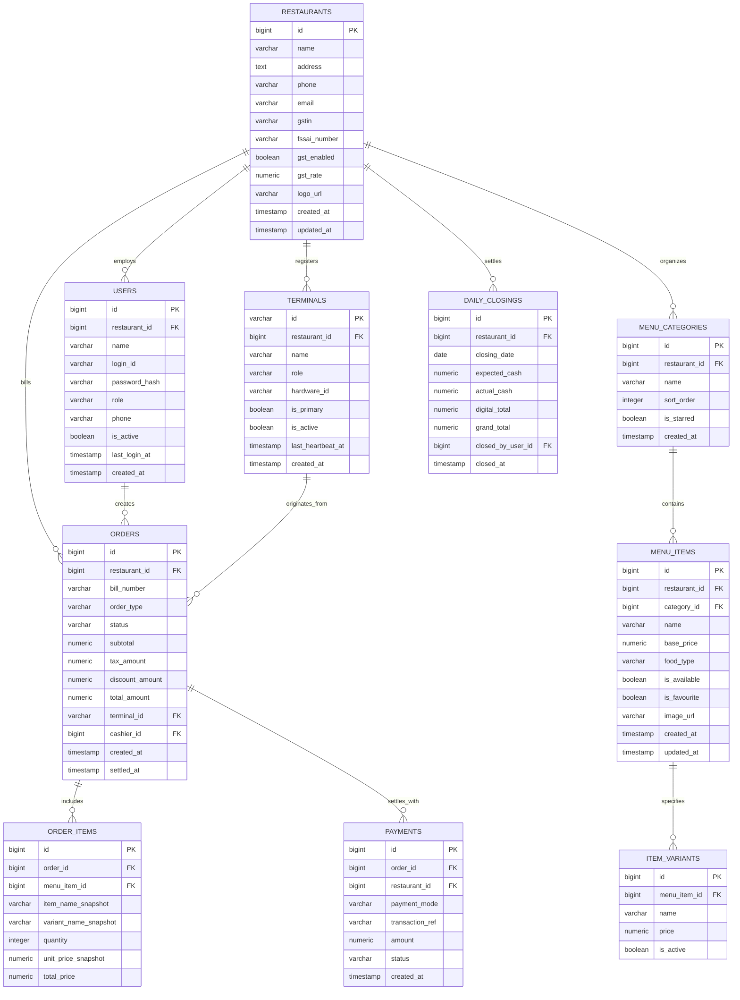

# KhanaBook — Database Schema & Data Model Specification (DATABASE.md)

**Document Version:** 2.0.0  
**Status:** Approved Source of Truth for Relational Schema  
**Database Engines:** PostgreSQL 16+ (Cloud Database) & SQLite 3 (Android Edge Terminals)  

---

## 1. Entity Relationship (ER) Diagram



---

## 2. Table Specifications & Column Definitions

### 2.1 `restaurants` (Business Profile & Multi-Tenant Root)
| Column | Type | Constraints | Description |
| :--- | :--- | :--- | :--- |
| `id` | `BIGINT` | Primary Key, Generated Always as Identity | Unique restaurant identifier |
| `name` | `VARCHAR(150)` | NOT NULL | Registered trading business name |
| `address` | `TEXT` | NULL | Full multi-line physical shop address |
| `phone` | `VARCHAR(15)` | NOT NULL | Primary contact/WhatsApp number |
| `email` | `VARCHAR(255)` | NULL | Official communication email |
| `gstin` | `VARCHAR(15)` | NULL | 15-character Indian GSTIN registration |
| `fssai_number` | `VARCHAR(14)` | NULL | 14-digit FSSAI license/registration |
| `gst_enabled` | `BOOLEAN` | NOT NULL DEFAULT false | Whether tax calculation is active |
| `gst_rate` | `NUMERIC(5,2)` | NOT NULL DEFAULT 5.00 | Applicable composite GST percentage |
| `logo_url` | `VARCHAR(500)` | NULL | URL to restaurant receipt/header logo |
| `created_at` | `TIMESTAMPTZ` | NOT NULL DEFAULT now() | Registration timestamp |
| `updated_at` | `TIMESTAMPTZ` | NOT NULL DEFAULT now() | Last update timestamp |

### 2.2 `users` (Staff & Authentication Accounts)
| Column | Type | Constraints | Description |
| :--- | :--- | :--- | :--- |
| `id` | `BIGINT` | Primary Key, Generated Always as Identity | Unique user ID |
| `restaurant_id` | `BIGINT` | Foreign Key -> `restaurants.id` | Tenant isolation scoping |
| `name` | `VARCHAR(100)` | NOT NULL | Staff member full name |
| `login_id` | `VARCHAR(100)` | NOT NULL | Username, phone, or email for login |
| `password_hash` | `VARCHAR(255)` | NOT NULL | Argon2id / BCrypt salted password hash |
| `role` | `VARCHAR(20)` | NOT NULL | `OWNER`, `MANAGER`, `CASHIER`, `KITCHEN` |
| `phone` | `VARCHAR(15)` | NULL | Staff mobile number |
| `is_active` | `BOOLEAN` | NOT NULL DEFAULT true | Account status; false prevents login |
| `last_login_at`| `TIMESTAMPTZ` | NULL | Timestamp of latest successful auth |
| `created_at` | `TIMESTAMPTZ` | NOT NULL DEFAULT now() | Creation timestamp |

### 2.3 `menu_items` & `item_variants`
* **`menu_items`:**
  * `id`: `BIGINT` (PK)
  * `restaurant_id`: `BIGINT` (FK -> `restaurants.id`)
  * `category_id`: `BIGINT` (FK -> `menu_categories.id`)
  * `name`: `VARCHAR(150)` (NOT NULL)
  * `base_price`: `NUMERIC(10,2)` (NOT NULL DEFAULT 0.00)
  * `food_type`: `VARCHAR(20)` (CHECK in `'VEG', 'NON_VEG', 'EGG', 'BEVERAGE'`)
  * `is_available`: `BOOLEAN` (NOT NULL DEFAULT true)
  * `is_favourite`: `BOOLEAN` (NOT NULL DEFAULT false)
  * `image_url`: `VARCHAR(500)` (NULL)
* **`item_variants`:**
  * `id`: `BIGINT` (PK)
  * `menu_item_id`: `BIGINT` (FK -> `menu_items.id` ON DELETE CASCADE)
  * `name`: `VARCHAR(50)` (NOT NULL, e.g. "Half", "Full", "Large")
  * `price`: `NUMERIC(10,2)` (NOT NULL)

### 2.4 `orders` & `order_items`
* **`orders`:**
  * `id`: `BIGINT` (PK)
  * `restaurant_id`: `BIGINT` (FK -> `restaurants.id`, Indexed)
  * `bill_number`: `VARCHAR(50)` (NOT NULL, Unique per restaurant)
  * `order_type`: `VARCHAR(20)` (`DINE_IN`, `TAKEAWAY`, `DELIVERY`)
  * `status`: `VARCHAR(20)` (`PENDING`, `COMPLETED`, `CANCELLED`, `REFUNDED`)
  * `subtotal`: `NUMERIC(10,2)` (NOT NULL)
  * `tax_amount`: `NUMERIC(10,2)` (NOT NULL DEFAULT 0.00)
  * `discount_amount`: `NUMERIC(10,2)` (NOT NULL DEFAULT 0.00)
  * `total_amount`: `NUMERIC(10,2)` (NOT NULL)
  * `terminal_id`: `VARCHAR(50)` (FK -> `terminals.id`)
  * `created_at`: `TIMESTAMPTZ` (NOT NULL DEFAULT now(), Indexed)

---

## 3. Database Indexes for Query Optimization

```sql
-- Tenant-scoped order queries & dashboard analytics
CREATE INDEX idx_orders_restaurant_created ON orders (restaurant_id, created_at DESC);
CREATE INDEX idx_orders_bill_lookup ON orders (restaurant_id, bill_number);

-- Menu item lookups by category and availability
CREATE INDEX idx_menu_items_restaurant_cat ON menu_items (restaurant_id, category_id, is_available);

-- Staff lookup by login identifier
CREATE UNIQUE INDEX idx_users_restaurant_login ON users (restaurant_id, login_id);

-- Terminal heartbeat & status lookup
CREATE INDEX idx_terminals_restaurant ON terminals (restaurant_id, is_active);
```

---

## 4. Tenant Isolation & Row-Level Security (RLS)

All cloud queries must strictly enforce multi-tenant isolation. When using PostgreSQL Row-Level Security:

```sql
ALTER TABLE orders ENABLE ROW LEVEL SECURITY;

CREATE POLICY tenant_isolation_orders ON orders
    FOR ALL
    USING (restaurant_id = current_setting('app.current_restaurant_id')::bigint);
```

---

## 5. Edge SQLite Sync & Migration Discipline

* **Local Android Schema:** Maintained via Room Database migrations (`MIGRATION_1_2.kt`, etc.).
* **Zero Destruction Rule:** Cloud and local migrations MUST NEVER drop production tables or truncate customer data during schema updates.
* **Seed Strategy:** Test environments initialize standard categories (`Appetizers`, `Main Course`, `Beverages`, `Breads`) and default terminal configurations without altering existing live businesses.
