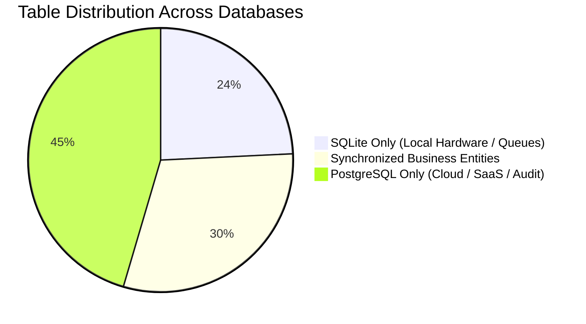

# 01 - Complete Database Inventory & Catalog
> **KhanaBook POS & SaaS Platform Architecture Audit**  
> **Target Engines:** SQLite (Android Room v84) & PostgreSQL 16 (`kbook_saas` at Flyway V130)  
> **Audit Mode:** READ-ONLY Forensic Discovery  

---

## 1. Executive Summary & Inventory Totals

- **SQLite Tables (Room v84):** **18 tables**
- **SQLite Columns:** **349 columns**
- **PostgreSQL Tables (`kbook_saas`):** **25 tables**
- **PostgreSQL Columns:** **393 columns**
- **Grand Total Platform Architecture:** **43 tables**, **742 columns**

---

## 2. Consolidated Master Table Catalog

| # | Database | Schema | Table Name | Total Columns | System / Business | Purpose | Relationships |
|---|---|---|---|---:|---|---|---|
| 1 | SQLite | main | `bill_items` | 21 | Business | Order line items, dish quantities, prices, KOT status | bills, menu_items, item_variants |
| 2 | SQLite | main | `bill_payments` | 21 | Business | Payment breakdown, cash/UPI splits, idempotency keys | bills |
| 3 | SQLite | main | `bills` | 56 | Business | Order records, bill numbers (daily_order_id), lifetime invoice numbers | bill_items, bill_payments |
| 4 | SQLite | main | `categories` | 14 | Business | Menu category hierarchy and display sorting | menu_items |
| 5 | SQLite | main | `item_variants` | 16 | Business | Portion sizes (Half/Full) and variant rate overrides | menu_items, bill_items |
| 6 | SQLite | main | `kitchen_print_queue` | 16 | Local Queue | Offline resilient KOT spooler buffer for thermal kitchen printers | printer_profiles, bills |
| 7 | SQLite | main | `kot_events` | 12 | Local Audit | Audit ledger of KOT prints and reprint events per bill | bills |
| 8 | SQLite | main | `local_cashier_shifts` | 25 | Business (Dormant) | Cashier shift float and drawer balancing (0 live rows) | users |
| 9 | SQLite | main | `menu_item_category_repairs` | 5 | Sync Diagnostics | Self-healing repair ledger for dishes pointing to missing remote categories | menu_items, categories |
| 10 | SQLite | main | `menu_items` | 26 | Business | Menu item catalog, pricing, food type, barcode | categories, item_variants, bill_items |
| 11 | SQLite | main | `notifications` | 10 | Business | Operational notifications and customer order updates | None |
| 12 | SQLite | main | `permission_cache` | 4 | Security Cache | Security privilege revision marker for fast offline access gating | users |
| 13 | SQLite | main | `printer_profiles` | 15 | Local Hardware | Local printer hardware configs (Bluetooth MAC, USB, Wi-Fi LAN 9100) | kitchen_print_queue |
| 14 | SQLite | main | `restaurant_profile` | 65 | Business | Store branding, tax configuration, business hours cutoff, singleton | None |
| 15 | SQLite | main | `staff_permissions` | 7 | Security Cache | Offline cashier PIN verification hashes and permissions | users |
| 16 | SQLite | main | `sync_quarantine_records` | 11 | Sync Diagnostics | Dead-letter queue for sync payloads rejected by server with 4xx/5xx | bills, restaurant_profile |
| 17 | SQLite | main | `terminal_daily_counter` | 6 | Local Operational | Atomic monotonic daily sequence generator per date and terminal | bills |
| 18 | SQLite | main | `users` | 19 | Business | Local staff cache and active terminal user details | bills, cashier_shifts |
| 19 | PostgreSQL | public | `bill_items` | 22 | Business (Synced) | Line items for customer bills, portions, prices, taxes | bills, menuitems, itemvariants |
| 20 | PostgreSQL | public | `bill_payments` | 18 | Business (Synced) | Tender transactions (Cash, UPI, Split) & idempotency keys | bills |
| 21 | PostgreSQL | public | `bills` | 43 | Business (Synced) | Central financial ledger of bills, GST invoices, and order status | bill_items, bill_payments |
| 22 | PostgreSQL | public | `cashier_shifts` | 26 | Business (Dormant) | Cash float shifts and EOD cash drawer reconciliation (0 rows) | users, restaurantprofiles |
| 23 | PostgreSQL | public | `categories` | 15 | Business (Synced) | Menu categories, display sort orders, favourite flags | menuitems |
| 24 | PostgreSQL | public | `device_registration_request` | 18 | Cloud Governance | Pending terminal enrollment requests awaiting Owner approval | restaurantprofiles |
| 25 | PostgreSQL | public | `device_tokens` | 9 | Cloud Infrastructure | FCM push notification tokens for Android devices | users, restaurantprofiles |
| 26 | PostgreSQL | public | `email_outbox` | 16 | Cloud Queue | Transactional email queue for PDF bills and EOD reports | restaurantprofiles |
| 27 | PostgreSQL | public | `feature_flag` | 6 | SaaS Governance | Platform-wide feature switches and feature gating | feature_flag_override |
| 28 | PostgreSQL | public | `feature_flag_audit` | 9 | Cloud Audit | Audit log of feature flag modifications by platform admins | feature_flag |
| 29 | PostgreSQL | public | `feature_flag_override` | 6 | SaaS Governance | Tenant-specific feature flag overrides | feature_flag, restaurantprofiles |
| 30 | PostgreSQL | public | `flyway_schema_history` | 10 | Framework / DB | Flyway schema migration tracking ledger (V1 through V130) | None |
| 31 | PostgreSQL | public | `itemvariants` | 18 | Business (Synced) | Portion rate options (Half, Full, Small, Large) | menuitems |
| 32 | PostgreSQL | public | `menu_extraction_jobs` | 8 | Cloud Queue | OCR processing queue for physical menu photo uploads | restaurantprofiles |
| 33 | PostgreSQL | public | `menuitems` | 25 | Business (Synced) | Dishes, prices, barcodes, availability status, photos | categories, itemvariants |
| 34 | PostgreSQL | public | `notification_events` | 12 | Cloud Queue | Transactional outbox for push notifications dispatched to FCM | restaurantprofiles |
| 35 | PostgreSQL | public | `otp_requests` | 7 | Security / Auth | SMS & WhatsApp OTP challenges with rate limits and expiry | None |
| 36 | PostgreSQL | public | `rate_limit_attempts` | 5 | Security / Auth | Brute-force protection for login, PIN, and OTP endpoints | None |
| 37 | PostgreSQL | public | `refresh_tokens` | 8 | Security / Auth | Cryptographically hashed JWT refresh tokens | users |
| 38 | PostgreSQL | public | `restaurant_terminal` | 14 | Cloud Governance | Enrolled POS terminals, series letters ('A'..'E'), active heartbeats | restaurantprofiles |
| 39 | PostgreSQL | public | `restaurantprofiles` | 43 | Business (Synced) | SaaS tenant settings, GSTIN, business hours cutoff, singleton | restaurant_terminal, bills |
| 40 | PostgreSQL | public | `security_audit_log` | 11 | Cloud Audit | Tamper-proof compliance log of all logins, edits, and privilege changes | users, restaurantprofiles |
| 41 | PostgreSQL | public | `stock_logs` | 16 | Business (Dormant) | Inventory stock movement tracking (0 rows in production) | menuitems, itemvariants |
| 42 | PostgreSQL | public | `token_blocklist` | 3 | Security / Auth | Revoked JWT identifiers (JTI) for instant session kill | None |
| 43 | PostgreSQL | public | `users` | 25 | Business (Synced) | Staff accounts, owner profiles, bcrypt password hashes, roles | restaurantprofiles, bills |

---

## 3. Discrepancy & Gap Analysis

### 3.1 Tables Present in SQLite ONLY (8 Tables)
These tables reside exclusively in Android SQLite to support sub-10ms counter latency and hardware isolation:
1. `printer_profiles` (15 cols) — Local hardware MAC addresses, paper size (58mm/80mm), USB endpoints.
2. `kitchen_print_queue` (16 cols) — Local offline resilient KOT queue buffers.
3. `kot_events` (12 cols) — Local kitchen ticket reprint lifecycle tracking.
4. `sync_quarantine_records` (11 cols) — Local dead-letter queue for rejected sync payloads.
5. `menu_item_category_repairs` (5 cols) — Local self-healing table for orphaned menu items.
6. `terminal_daily_counter` (6 cols) — Local atomic monotonic daily bill number counter.
7. `staff_permissions` (7 cols) — Local offline staff permissions and PIN verification cache.
8. `permission_cache` (4 cols) — Local permission revision gate.

### 3.2 Tables Present in PostgreSQL ONLY (15 Tables)
These tables exist exclusively in the cloud backend for SaaS governance, queues, and security:
1. `security_audit_log` (11 cols) — Compliance audit trail (5,500+ records).
2. `email_outbox` (16 cols) — Transactional PDF invoice and daily closing email spooler.
3. `notification_events` (12 cols) — Outbox for Google FCM push multicasts.
4. `device_tokens` (9 cols) — FCM device registration tokens.
5. `device_registration_request` (18 cols) — Terminal pairing and approval handshake records.
6. `restaurant_terminal` (14 cols) — Terminal fleet registry, series letters (`A`..`E`), and heartbeats.
7. `rate_limit_attempts` (5 cols) — Rate limiting security records.
8. `refresh_tokens` (8 cols) — JWT session refresh tokens.
9. `token_blocklist` (3 cols) — Blacklisted JWT IDs (JTI).
10. `otp_requests` (7 cols) — SMS / WhatsApp OTP verification queue.
11. `feature_flag` (6 cols) — System-wide feature toggles.
12. `feature_flag_override` (6 cols) — Per-restaurant feature overrides.
13. `feature_flag_audit` (9 cols) — Audit log of feature flag adjustments.
14. `menu_extraction_jobs` (8 cols) — Cloud OCR menu parsing worker jobs.
15. `flyway_schema_history` (10 cols) — Database migration version registry.

### 3.3 Synchronized Shared Entities (10 Tables)
1. `bills` ↔ `bills`
2. `bill_items` ↔ `bill_items`
3. `bill_payments` ↔ `bill_payments`
4. `categories` ↔ `categories`
5. `menu_items` ↔ `menuitems`
6. `item_variants` ↔ `itemvariants`
7. `restaurant_profile` ↔ `restaurantprofiles`
8. `users` ↔ `users`
9. `local_cashier_shifts` ↔ `cashier_shifts` (dormant)
10. `notifications` ↔ `notification_events` (pull alerts)

### 3.4 Inactive / Dormant Tables in Production
- `cashier_shifts` / `local_cashier_shifts`: 0 rows in PostgreSQL. The application uses Business Hours (`00:00 - 23:59` calendar or custom `< 24h` cutoff) instead of cashier shifts.
- `stock_logs`: 0 rows in PostgreSQL. Inventory deduction is tracked via `bills.inventory_deducted`.
