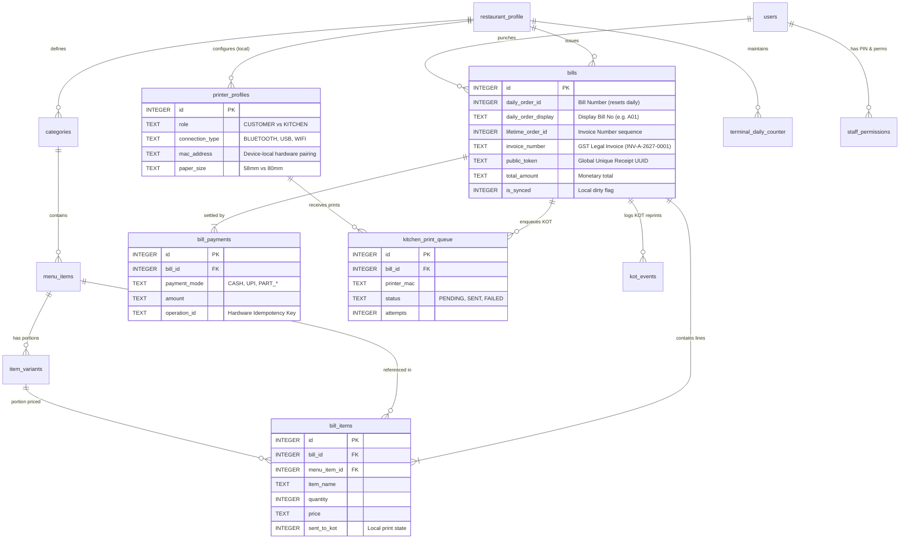
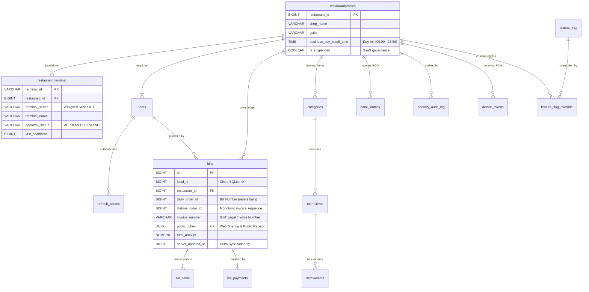
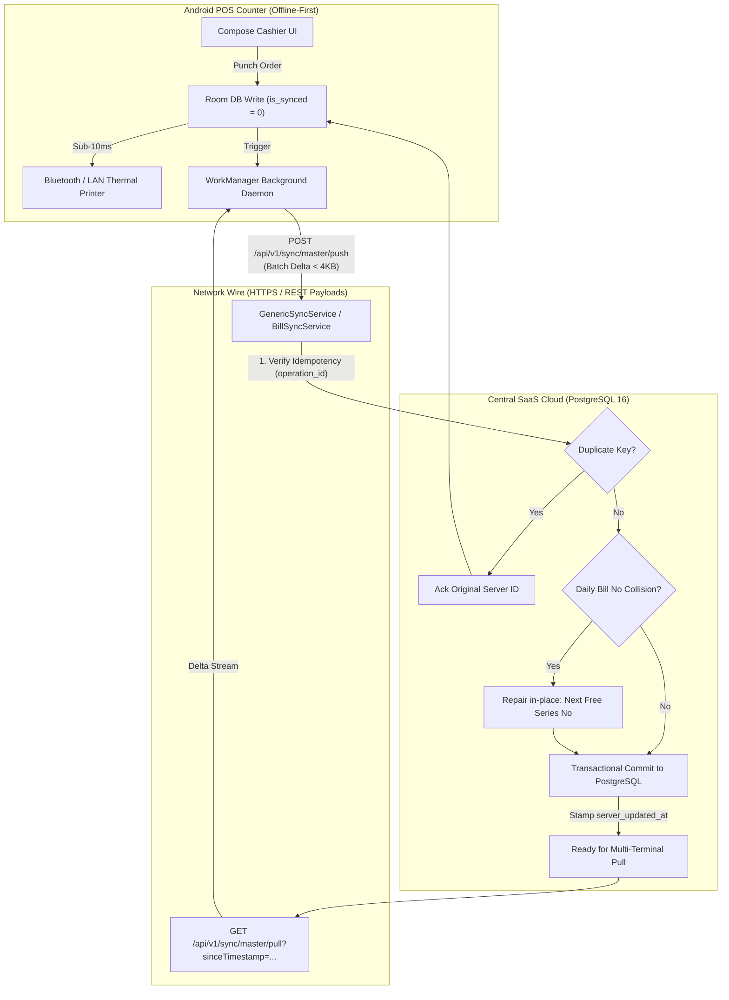

# 05 - Entity-Relationship Diagrams (ERD)
> **KhanaBook POS & SaaS Database Architecture**  
> **Engine Models:** Android Room SQLite (v84) & PostgreSQL 16 (`kbook_saas` at Flyway V130)  

---

## 1. Android POS Local SQLite Architecture (Room v84)

---

## 2. PostgreSQL SaaS Central Production ERD (`kbook_saas`)

---

## 3. Bi-Directional Delta Sync & Idempotency Pipeline

