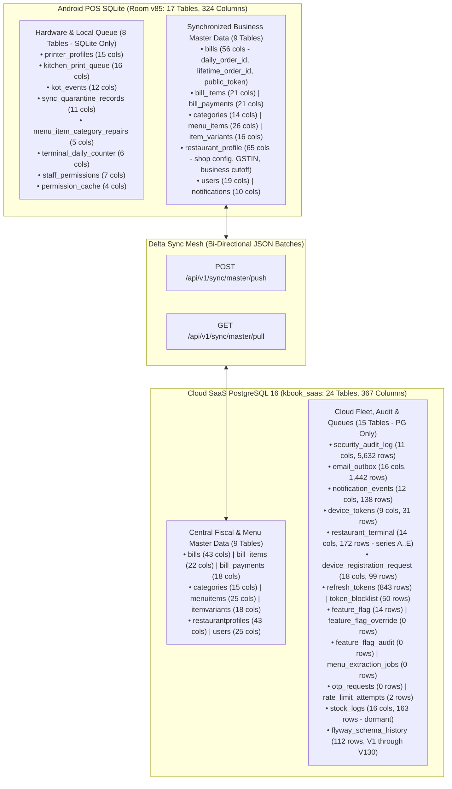

# 10 - Database Architecture Authoritative Baseline Report
> **KhanaBook POS & Cloud SaaS Platform Architecture**  
> **Auditors:** Senior Database Architect & Independent Database Auditor  
> **Engines:** PostgreSQL 16.15 (`kbook_saas`) & SQLite Room Schema Version 84  
> **Status:** AUTHORITATIVE BASELINE ESTABLISHED (STRICT READ-ONLY)  

---

## 1. Verified Database Architecture Counts

| Metric Category | PostgreSQL 16 (`public`) | SQLite (Room Schema v84) | Grand Total Architecture | Evidence Source |
|---|:---:|:---:|:---:|---|
| **Total Tables** | **25 tables** | **18 tables** | **43 tables** | `information_schema.tables` & `84.json` |
| **Total Columns** | **393 columns** | **349 columns** | **742 columns** | `information_schema.columns` & `84.json` |
| **Primary Keys** | **25 PKs** | **18 PKs** | **43 PKs** | `information_schema.table_constraints` & `84.json` |
| **Foreign Keys** | **31 FKs** | **6 FKs** | **37 FKs** | `information_schema.referential_constraints` & `84.json` |
| **Unique Constraints / Indices**| **58 Unique** | **12 Unique** | **70 Unique** | `pg_constraint` & `84.json` indices |
| **Check Constraints** | **10 Checks** | **0 Checks** | **10 Checks** | `pg_constraint (contype = 'c')` |
| **Total Indexes** | **151 indexes** | **35 indices** | **186 indexes** | `pg_indexes` & `84.json` indices |
| **Views / Materialized Views** | **0** | **0** | **0** | `information_schema.views` |
| **Triggers** | **0** | **0** | **0** | `information_schema.triggers` |
| **Sequences** | **7 sequences** | **1 sequence** | **8 sequences** | `information_schema.sequences` & `sqlite_sequence` |
| **Recorded Migration Steps** | **112 rows** (`V1`..`V130`) | **67 migrations** (`17`..`84`)| **179 migrations** | `flyway_schema_history` & `ALL_MIGRATIONS` |

---

## 2. Platform Entity Topology

---

## 3. Authoritative Findings & Established Facts

1. **Physical Room Schema Reality:**
   - Room schema is strictly at **Version 84** ([`84.json`](file:///var/www/kbook.iadv.cloud/apps/android/app/schemas/com.khanabook.lite.pos.core.database.AppDatabase/84.json)).
   - In SQLite table `restaurant_profile`, **9 printer-related columns** (`printer_enabled`, `printer_name`, `printer_mac`, `paper_size`, `printer_mode`, `kitchen_printer_*`) physically exist in SQLite. Kotlin `@Deprecated` annotations do not alter SQLite physical structure.
   - Dedicated table `printer_profiles` (15 cols) exists alongside `restaurant_profile`.
2. **Flyway Migration Ledger Drift:**
   - Script [`V131__add_active_order_and_delta_sync_covering_indexes.sql`](file:///var/www/kbook.iadv.cloud/services/server/src/main/resources/db/migration/V131__add_active_order_and_delta_sync_covering_indexes.sql) exists on disk.
   - Its 4 covering indexes (`idx_bills_active_created`, `idx_bills_active_status_created`, `idx_menuitems_active_sync`, `idx_bill_payments_sync_pull`) physically exist in PostgreSQL metadata.
   - However, `flyway_schema_history` stops at **V130** (rank 113).
   - This state is preserved as an active documented discrepancy.
3. **Core Identifiers Preserved:**
   - `daily_order_id` (Bill Number): Preserved across both engines, resetting to `1` daily based on Business Hours cutoff.
   - `lifetime_order_id` (Invoice Number): Maintained for lifetime sequence auditability.
   - `part_amount_1` / `part_amount_2`: Preserved for split payment reconciliation.
   - `barcode`: Preserved for camera OCR scanning.
4. **Items That Could Not Be Verified:**
   - Long-term disk I/O performance of indexes under 100,000+ daily bill volume (could not be verified because database currently holds 2,306 bills).
   - Production behavior of dormant cashier shifts (0 rows in live database).

---

## 4. Documentation Index

The complete 10-document authoritative database architecture suite is committed under [`docs/database-architecture/`](file:///var/www/kbook.iadv.cloud/docs/database-architecture/):

1. [`01-postgresql-live-schema.md`](file:///var/www/kbook.iadv.cloud/docs/database-architecture/01-postgresql-live-schema.md) — PostgreSQL 16 live schema (25 tables, 393 cols, row counts).
2. [`02-sqlite-room-schema.md`](file:///var/www/kbook.iadv.cloud/docs/database-architecture/02-sqlite-room-schema.md) — Android Room v84 schema (18 tables, 349 cols, printer coexistence).
3. [`03-flyway-migration-inventory.md`](file:///var/www/kbook.iadv.cloud/docs/database-architecture/03-flyway-migration-inventory.md) — 113 migration files vs 112 Flyway rows & V131 status.
4. [`04-room-migration-inventory.md`](file:///var/www/kbook.iadv.cloud/docs/database-architecture/04-room-migration-inventory.md) — 67 unbroken Room migrations (17 to 84) & `ShiftMigrations.kt`.
5. [`05-cross-database-entity-mapping.md`](file:///var/www/kbook.iadv.cloud/docs/database-architecture/05-cross-database-entity-mapping.md) — 43-table cross-database mapping with 6-tier classification.
6. [`06-relationships-and-constraints.md`](file:///var/www/kbook.iadv.cloud/docs/database-architecture/06-relationships-and-constraints.md) — 124 constraints, PKs, FKs, Unique checks, cascade rules.
7. [`07-index-inventory.md`](file:///var/www/kbook.iadv.cloud/docs/database-architecture/07-index-inventory.md) — 151 PostgreSQL indexes, 35 SQLite indices, and index selection facts.
8. [`08-offline-sync-data-architecture.md`](file:///var/www/kbook.iadv.cloud/docs/database-architecture/08-offline-sync-data-architecture.md) — 12 offline-first operational behaviors with source code citations.
9. [`09-schema-discrepancy-report.md`](file:///var/www/kbook.iadv.cloud/docs/database-architecture/09-schema-discrepancy-report.md) — 3-way reconciliation matrix with 7 classified discrepancies.
10. [`10-database-architecture-baseline.md`](file:///var/www/kbook.iadv.cloud/docs/database-architecture/10-database-architecture-baseline.md) — Executive architecture baseline and topological summary.
