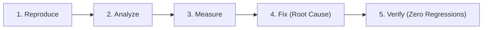

# Senior Engineering Debugging Standard

This protocol governs how bugs, regressions, and performance bottlenecks are investigated and resolved across the KhanaBook platform (Android POS, Spring Boot SaaS, Angular Web Admin, and PostgreSQL).

> **Core Axiom:** Senior engineers do not guess. They rely on evidence. The goal is to find the correct root cause quickly, not to apply hasty patches that mask symptoms.

---

## The 5-Step Protocol

### 1. Reproduce
*If you cannot reproduce the issue, you cannot reliably verify a fix.*
- **Identify Preconditions:** Device state, database snapshot, network connectivity mode (offline vs online), user roles (`OWNER`, `SHOP_STAFF`, `KBOOK_ADMIN`).
- **Isolate the Trigger:** Exact sequence of user gestures, sync payload triggers, or API calls.
- **Form a Test Case:** Capture minimal failing integration/unit test or deterministic manual reproduction steps.

### 2. Analyze
*Collect ground-truth facts before forming hypotheses.*
- **Android POS:** Logcat tag filtering (`tag:MasterSync`, `tag:PrintRouter`, `tag:Billing`), Room SQLite Inspector, ViewModel StateFlow traces.
- **Backend SaaS:** Structured JSON container logs (`docker logs kbookiadvcloud-server-1`), Spring Actuator `/health` and `/metrics`.
- **Wire Contract:** Raw JSON request/response bodies, HTTP headers, compression envelopes.
- **Database:** PostgreSQL queries, `EXPLAIN ANALYZE`, lock contention (`pg_locks`), row counts.

### 3. Measure
*Never assume where latency or errors originate.*
- **Time Profiling:** Measure network roundtrip vs database query execution vs client serialization vs UI rendering time.
- **Resource Footprint:** Memory allocations (Heap/RAM), HikariCP connection pool usage, thread starvation.
- **Payload Sizes:** Verify byte counts before and after gzip compression.

### 4. Fix (Root Cause Only)
*Implement the smallest, most surgical change that addresses the fundamental failure.*
- ❌ Do not apply band-aids (e.g. adding `try-catch { ignore }`, random `sleep()`, or blind null-coalescing).
- ❌ Do not change multiple unrelated things simultaneously.
- ✅ Fix the single root defect (e.g. schema drift, missing SQL index, race condition in coroutine flow).

### 5. Verify
*Prove the fix works without unintended side effects.*
- ✅ Confirm reproduction scenario now passes cleanly.
- ✅ Run regression test suite (`mvn test`, `./gradlew test`).
- ✅ Check edge cases (offline mode, network disconnect mid-sync, multi-terminal concurrency).
- ✅ Pre-flight backup and Flyway validation before any production deployment.

---

## Anti-Patterns (Banned Practices)
1. **Shotgun Debugging:** Modifying multiple files and configurations at once hoping something works.
2. **Symptom Suppression:** Catching exceptions and logging warnings without resolving why they were thrown.
3. **Ghost Assumption:** Blaming network/OS/framework before inspecting the actual logs and metrics.
4. **Skipping Verification:** Declaring a bug fixed without reproducing it under identical conditions.
