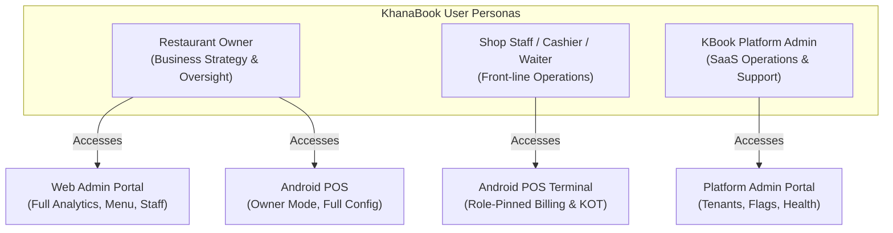

# 01 - Product Overview & Business Architecture
> **KhanaBook SaaS Platform Discovery & Architecture Specification**  
> **Product Name:** KhanaBook (KhanaBook Lite POS / KhanaBook SaaS)  
> **Repository:** `/var/www/kbook.iadv.cloud`  
> **Document:** `docs/product-understanding/01-product-overview.md`  
> **Status:** Active / Production  

---

## 1. Product Identity

### 1.1 One-Line Product Definition
**KhanaBook is an offline-first, multi-terminal restaurant billing and operations SaaS platform combining an autonomous Android POS terminal with cloud synchronization and a central Angular web administration portal.**

### 1.2 Short Business Overview
KhanaBook is purpose-built for Indian quick-service restaurants (QSRs), cafes, bakeries, food trucks, and casual dining outlets. It solves the existential problem of restaurant operations in emerging markets: **unreliable internet connectivity causing lost orders and delayed billing at checkout.** Unlike cloud-only POS systems that stall when the internet fails, KhanaBook executes all order creation, GST calculation, split tendering, and thermal ESC/POS kitchen and customer printing locally on an Android device with zero network latency. When connectivity is restored, it reconciles local transactions with a central PostgreSQL cloud server via an optimistic, conflict-safe delta synchronization engine, providing restaurant owners with unified remote analytics and fleet terminal management.

### 1.3 Detailed Product Explanation
KhanaBook operates on a distributed hybrid architecture:
1. **At the Counter / Table:** Android terminals run natively using Kotlin, Jetpack Compose, and an encrypted local SQLite database (Room v84). Cashiers and waiters create bills, fire Kitchen Order Tickets (KOT) to thermal printers over Bluetooth/USB/LAN, apply discounts, and tender payments (Cash, UPI QR, Split) in milliseconds without making a single blocking cloud network call.
2. **In the Background:** A serialized delta synchronization engine (`SyncManager` and `MasterSyncProcessor`) monitors network availability, queues offline transactions, pushes paged batches (100 bills, 200 items/payments) to the cloud, and pulls menu or configuration updates.
3. **In the Cloud:** A multi-tenant Spring Boot 3 Java backend (`services/server`) running on PostgreSQL 16 validates tenant isolation (`TenantContext`), assigns global server UUIDs, aggregates sales and GST compliance metrics, and coordinates device registration across terminals.
4. **On the Owner's Desk:** An Angular 19 PWA Web Administration Portal (`apps/web-admin`) gives restaurant owners real-time visibility into the live dining floor, consolidated multi-terminal reports, daily closing reconciliation, menu editing, and staff management without interfering with active billing counters.

---

## 2. Business Problem & Market Need

### 2.1 The Problem Space
Small and mid-sized food businesses operate in high-pressure, high-volume environments characterized by:
- **Frequent Internet Disruptions:** Fiber cuts, Wi-Fi router reboots, and 4G cell congestion stall conventional cloud-first POS systems, creating long checkout queues, frustrated patrons, and lost sales.
- **Counter Concurrency Conflicts:** Multiple checkout counters operating simultaneously risk colliding on bill numbers, overwriting open tabs, or double-booking tables.
- **Complex Indian Tax & Invoice Rules:** GST requirements require accurate tax-inclusive and tax-exclusive calculations, HSN/SAC categorisation, daily counter resets, and sequential financial year invoice sequences.
- **Hardware Fragmentation:** Restaurant operators use diverse thermal printers (58mm and 80mm paper, Bluetooth SPP, USB OTG, Ethernet raw port 9100) and need kitchen printing (KOT) to work independently of cloud connectivity.
- **Operational Vulnerabilities:** Cashiers may manipulate orders, delete line items, or issue unauthorised discounts when the owner is absent.

### 2.2 How KhanaBook Solves These Problems
| Conventional Cloud POS | KhanaBook Offline-First POS |
|---|---|
| Latency on every item tap (HTTP round-trip) | 0ms instant UI rendering from local SQLite database |
| Billing stops immediately during internet outage | 100% full offline capability for billing, printing, and reports |
| Monolithic bill numbering collides across devices | Isolated terminal series (`A`, `B`, `C`, `D`, `E`) with atomic daily sequences |
| Cloud downtime locks out store operations | Terminals operate autonomously for days; sync resumes automatically |
| Complex expensive proprietary hardware | Runs on affordable standard Android tablets, phones, and POS terminals |

---

## 3. Target Customers & User Personas

### 3.1 Supported Industry Verticals
- **Quick Service Restaurants (QSRs) & Fast Food Counters:** High order velocity, walk-in counter ordering, rapid receipt and token printing.
- **Cafes, Juice Bars & Beverage Outlets:** Split payments (Cash + UPI), custom item variants (Small/Medium/Large), item modifier notes.
- **Bakeries & Sweet Stalls:** Barcode scanning integration, daily batch closing, takeaway workflows.
- **Food Trucks & Pop-up Kiosks:** Mobile battery-operated Android hardware, Bluetooth thermal printing, intermittent cellular connectivity.
- **Casual Dining & Small Restaurants:** Multi-terminal table management, Kitchen Order Tickets (KOT), floor order status tracking.

### 3.2 User Personas

#### 1. Restaurant Owner ("Ramesh" — Outlet Owner)
- **Primary Goals:** Remote visibility into daily net revenue, cash drawer reconciliation, menu price control, fraud prevention, GST filing compliance.
- **Key Workflows:** Views business dashboard, checks Live Floor, performs Daily Closing review, updates menu prices, downloads GST sales ledger, registers new POS terminals.
- **Touchpoints:** Web Admin Portal (`/business/**`) and Android POS in Owner mode.

#### 2. Cashier / Waiter ("Suresh" — Shop Staff)
- **Primary Goals:** High-speed order entry, instant thermal KOT dispatch to kitchen, accurate bill calculation, split payment collection, zero system crashes during peak rush.
- **Key Workflows:** Creates orders, adds modifiers, dispatches KOTs, selects payment mode (Cash, UPI QR, Part/Split), prints thermal receipts, reprints kitchen tickets.
- **Touchpoints:** Android POS terminal only (strictly restricted from Web Admin login).

#### 3. SaaS Platform Operator ("Priya" — KBook Super Admin)
- **Primary Goals:** Multi-tenant platform health, feature flag rollout, system tenant suspension/activation, audit inspection.
- **Key Workflows:** Monitors tenant fleet, inspects server sync metrics, reviews security audit logs, configures global feature flags.
- **Touchpoints:** Web Admin Portal under `/admin/**` routes.

---

## 4. Core Value Proposition & Competitive Differentiation

1. **True Offline-First Resilience:** Local Room database is the authoritative local master. The POS terminal never waits for HTTP requests during active billing.
2. **Terminal Series Isolation:** Eliminates counter collisions through deterministic terminal prefixing (`A01`, `B01`) while maintaining unified restaurant-wide reporting.
3. **Hardware Independence:** Direct ESC/POS bytecode generation supporting Bluetooth SPP, USB OTG, and network sockets without third-party printer drivers.
4. **Zero-Lockout Security:** Pinned role-bound permissions (18 fixed actions for `SHOP_STAFF`) cached locally in SQLite prevent offline privilege escalation while maintaining cashier autonomy.
5. **Modern Free Lifetime Tier:** 100% free core billing, POS operations, and multi-terminal sync without recurring software subscription paywalls.

---

## 5. Current vs. Planned Capabilities

| Capability Domain | Currently Implemented & Verified | Planned / Roadmap Evolution |
|---|---|---|
| **Billing & Invoicing** | Dine-in, Takeaway, Split Payments, Discounts, Void, Thermal Receipts, PDF Invoices | Table layout graphical floor planner |
| **Kitchen Operations** | Event-sourced KOT printing, reprint queue, void slips | Interactive Kitchen Display Screen (KDS) PWA |
| **Menu & Catalog** | Categories, Items, Variants (Half/Full), Favorites, Barcode scanning, AI/OCR extraction | Dynamic real-time recipe-based raw material deduction |
| **Payments** | Cash, UPI QR on-screen display, Split (Part 1/Part 2), Thermal receipt QR | Integrated mPOS / smart EDC card terminal SDKs |
| **Sync & Multi-Counter** | Paged batch delta sync (100 bills/batch), LWW conflict resolution, terminal series A..E | P2P local LAN sync between terminals during internet blackouts |
| **Reporting & GST** | Terminal-scoped daily summary, full day ledger, GST B2B/B2C reporting, CSV export | Direct automated GSTR-1 government portal filing |
| **Customer Engagement** | Phone lookup, WhatsApp digital bill link delivery | Customer loyalty points, automated promotional SMS |
