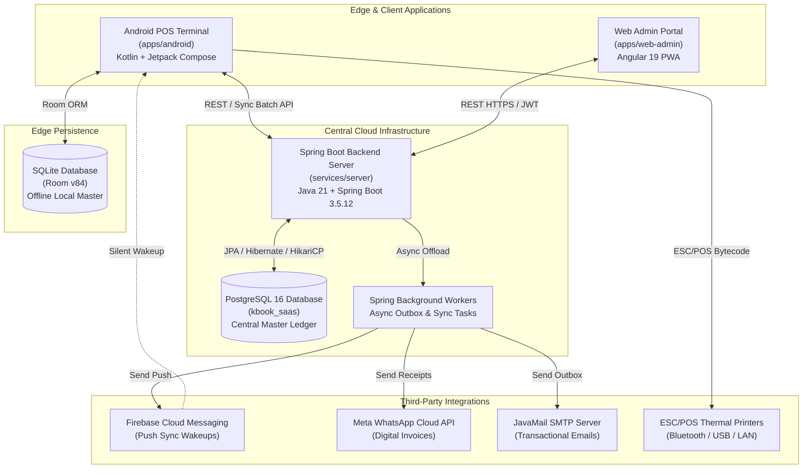

# 02 - Complete Platform Inventory & Architecture
> **KhanaBook SaaS Platform Discovery & Architecture Specification**  
> **Repository:** `/var/www/kbook.iadv.cloud`  
> **Document:** `docs/product-understanding/02-platform-inventory.md`  
> **Status:** Active / Production  

---

## 1. Discovered Platforms & System Components

KhanaBook consists of three primary software platforms, two database engines, and three background support subsystems.

---

## 2. Platform Inventory Matrix

| Platform / Subsystem | Codebase Location | Target User | Technology Stack | Implementation Status | Main Responsibilities |
|---|---|---|---|---|---|
| **Android POS Terminal** | `apps/android/` | Cashiers, Waiters, Store Owners | Kotlin 2.0, Jetpack Compose, Room (SQLite), Coroutines, Flow, Hilt, Retrofit, WorkManager | **FULLY IMPLEMENTED** | High-speed billing, offline order persistence, KOT thermal printing, customer receipts, local reports, camera barcode scanning, background delta sync. |
| **Web Admin Portal (Business)** | `apps/web-admin/` (routes `/business/**`) | Restaurant Owners | Angular 19, TypeScript, Tailwind CSS, Native HTML5 Dialogs, RxJS, Chart.js | **FULLY IMPLEMENTED** | Remote live floor monitoring, multi-terminal order history, daily closing reconciliation, menu editing, staff management, terminal fleet governance. |
| **Platform Admin Portal (SaaS)** | `apps/web-admin/` (routes `/admin/**`) | KhanaBook Platform Super Admins | Angular 19, TypeScript, Tailwind CSS | **PARTIALLY IMPLEMENTED** | Platform metrics, tenant business management, feature flag toggles, system health, audit logs. (Commission and payment routing sub-panels are currently partial). |
| **Backend & Sync API Server** | `services/server/` | Android Terminals & Web Admin | Java 21, Spring Boot 3.5.12, Spring Security 6, Spring Data JPA, Flyway, HikariCP | **FULLY IMPLEMENTED** | Multi-tenant REST APIs, JWT authentication, optimistic concurrency sync engine, ID mapping, transactional outbox dispatch, audit logging. |
| **Local Terminal Database** | Local device (`AppDatabase.kt`) | Android POS Engine | SQLite (Room DB schema version 84, 18 tables) | **FULLY IMPLEMENTED** | Full offline transactional storage, local sequence numbering, hardware printer profiles, KOT queues, sync quarantine. |
| **Central Cloud Database** | Docker / Host (`kbook_saas`) | Backend Server | PostgreSQL 16 (Flyway migrations V1 through V130, 25 tables) | **FULLY IMPLEMENTED** | Multi-tenant single-database shared-schema master persistence, relational constraints, delta sync indexing, tenant isolation. |
| **Background Sync Workers** | `apps/android/` (`SyncWorker.kt`) | Android System Scheduler | Android Jetpack WorkManager | **FULLY IMPLEMENTED** | Periodic network-constrained sync, app background sync wakeup, failure backoff retries. |
| **Server Async Scheduled Workers** | `services/server/` (`ScheduledTasks.java`) | Background Automation | Spring `@Async`, `@Scheduled`, ThreadPoolTaskExecutor (10 threads) | **FULLY IMPLEMENTED** | Email outbox draining, token blocklist cleanup, FCM notification offload, device health heartbeat processing. |
| **Kitchen Printing Subsystem** | `apps/android/` (`feature/printing/`) | Kitchen Staff & Expediter | Direct ESC/POS bytecode, Android Bluetooth SPP, USB OTG, Network Sockets | **FULLY IMPLEMENTED** | Event-sourced KOT slips, thermal auto-cutter, sound buzzer, local retry queue (`kitchen_print_queue`). |
| **Customer Digital Delivery** | `services/server/` (`NotificationService.java`) | Restaurant Customers | Meta WhatsApp Cloud API, JavaMail SMTP, PDF Generation | **FULLY IMPLEMENTED** | Automated WhatsApp bill summary link and PDF invoice email dispatch upon bill settlement. |

---

## 3. Platform Dependencies & Inter-Communication Protocols

### 3.1 Android POS ↔ Backend Server
- **Communication Protocol:** REST over HTTPS with TLS 1.3.
- **Authentication:** Dual-token security model:
  1. `Authorization: Bearer <JWT>` — Scoped to authenticated user ID, tenant `restaurantId`, and role (`OWNER` or `SHOP_STAFF`).
  2. `X-Terminal-Token: <JWT>` — Cryptographically ties the request to a registered device hardware fingerprint and assigned terminal series (`A`..`E`).
- **Data Exchange Format:** Compressed JSON payloads via Gson.
- **Sync Pattern:** Delta Synchronization:
  - **Push:** Device queries unsynced records (`is_synced = 0`), orders by foreign-key hierarchy (Categories → Menu Items → Item Variants → Bills → Bill Items → Bill Payments), chunks into pages (100 bills, 200 items/payments), and pushes to `/sync/*`.
  - **Push Acknowledgment:** Server executes atomic batch upsert and returns `successfulLocalIds` along with `localToServerIdMap`. Local rows update `is_synced = 1` and store assigned `server_id`.
  - **Pull:** Device requests `/sync/master/pull?lastSyncTimestamp=<epoch>`. Server streams updated records. Local device applies last-write-wins (LWW) with clock-skew bounds.

### 3.2 Web Admin ↔ Backend Server
- **Communication Protocol:** REST over HTTPS.
- **Authentication:** `Authorization: Bearer <JWT>` stored in session/local storage, transmitted via Angular HTTP Interceptor.
- **Data Exchange Format:** Standard JSON payloads mapped to Angular TypeScript interfaces.
- **Operation Mode:** Real-time online querying. Web Admin does NOT maintain a local SQLite database; it operates directly against the PostgreSQL cloud master.

### 3.3 Hardware Peripheral Communication (Android POS)
- **Bluetooth SPP (RFCOMM):** Standard UUID `00001101-0000-1000-8000-00805F9B34FB`. Direct socket streaming of ESC/POS byte arrays.
- **USB OTG:** `UsbManager` interface communicating directly with thermal printer bulk transfer endpoints.
- **Ethernet / Wi-Fi Network Printers:** Raw TCP socket streaming directly to IP port `9100`.

---

## 4. Platform Lifecycle Classification

### 4.1 Fully Implemented & In Production
- Android POS Billing, Orders, and KOT engine (`apps/android`).
- Web Admin Business Dashboard, Orders Live Floor, Menu Editor, Reports, Daily Closing (`apps/web-admin`).
- Spring Boot Multi-Tenant Backend with PostgreSQL 16 (`services/server`).
- Delta sync engine with terminal series isolation.
- WhatsApp invoice delivery and Email Outbox worker.

### 4.2 Partially Implemented / In Transition
- **Super Admin Platform (`/admin/**`):** Tenant listing, feature flags, and system health are fully operational. However, commission routing and webhook debug views are currently UI stubs without complete backing controllers.
- **Cashier Shifts:** Local Room table `local_cashier_shifts` and server table `cashier_shifts` exist in schema with full models, but live UI workflows currently operate on Daily Closing summaries without mandatory cashier shift clock-in/clock-out gating.

### 4.3 Deprecated / Purged (Architectural Simplification)
- **Subscription Billing:** All subscription plans, recurring paywalls, and merchant billing tables (`subscription_plans`, `restaurant_subscriptions`) were officially **PURGED** in Flyway V124. The platform is 100% Free Lifetime.
- **Dynamic Permission Revisions:** Custom per-user permission overrides and `role_templates` were retired in V124 in favor of constant role-bound sets.
- **Marketplace Integrations:** Third-party aggregator tables (`zomato_orders`, `swiggy_orders`) were purged in V123/V125 to eliminate bloat and focus on direct on-premise dining and takeaway.
- **Sub-Merchant Payment Escrow:** Multi-tenant Easebuzz gateway sub-merchant onboarding tables were purged in V129 in favor of direct merchant UPI QR and cash settlement.
