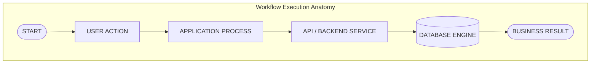

# 05 - Complete Business Workflows
> **KhanaBook SaaS Platform Discovery & Architecture Specification**  
> **Repository:** `/var/www/kbook.iadv.cloud`  
> **Document:** `docs/product-understanding/05-business-workflows.md`  
> **Status:** Active / Production  

---

## 1. Trace Matrix of Real-World Workflows

Every workflow follows the rigorous execution path:
**START → USER ACTION → APPLICATION PROCESS → API/SERVICE → DATABASE → RESULT**

---

## 2. End-to-End Workflow Traces

### Workflow 1: Restaurant Onboarding & Owner Registration
- **Business Goal:** Create a new restaurant tenant, register the owner credentials, and initialize the store profile.
- **Trace:**
  1. **START:** Owner downloads KhanaBook Lite POS Android app or visits Web Admin `/login`.
  2. **USER ACTION:** Enters mobile number, restaurant name, and taps "Send OTP".
  3. **APPLICATION PROCESS:** `AuthViewModel` validates 10-digit Indian mobile format; renders OTP input screen.
  4. **API / SERVICE:** Client calls `POST /auth/request-otp`. Backend `AuthServiceImpl` verifies rate limits (`rate_limit_attempts`), generates secure 6-digit OTP, stores record in `otp_requests`, and dispatches via SMS provider.
  5. **USER ACTION:** Owner inputs 6-digit OTP received via SMS.
  6. **API / SERVICE:** Client calls `POST /auth/verify-otp`. Backend verifies OTP hash, creates a new entry in `restaurantprofiles` (assigning a new `tenantId`), creates a user in `users` with role `OWNER`, and issues a JWT access and refresh token pair.
  7. **DATABASE:**
     - Insert into `restaurantprofiles` (`id = :tenantId`, `shop_name = :name`).
     - Insert into `users` (`id = :userId`, `restaurant_id = :tenantId`, `role = 'OWNER'`).
  8. **RESULT:** Owner authenticated; Android initializes local Room DB singleton profile; redirects to Quick Setup wizard.

---

### Workflow 2: Terminal Registration & Fleet Approval
- **Business Goal:** Pair a secondary Android phone/tablet to an existing restaurant counter without allowing rogue devices to push unauthorized data.
- **Trace:**
  1. **START:** Cashier opens KhanaBook on Counter B terminal.
  2. **USER ACTION:** Cashier logs in with staff credentials.
  3. **APPLICATION PROCESS:** `SessionManager.kt` detects no active `terminal_token`. Generates unique Android hardware fingerprint (`deviceId`).
  4. **API / SERVICE:** Android calls `POST /sync/terminal/activate`. Backend `TerminalController` detects that Counter A already exists as the primary terminal. It creates a `device_registration_request` with status `PENDING` and returns HTTP 202 Accepted (`TerminalPendingApprovalException`).
  5. **APPLICATION PROCESS:** Android terminal displays "Device Pending Approval" screen and initiates background polling.
  6. **USER ACTION:** Restaurant Owner opens Web Admin `/business/terminals`. Sees Counter B pending request with hardware device name. Clicks "Approve" and assigns Terminal Series `B`.
  7. **API / SERVICE:** Web Admin calls `POST /business/terminals/requests/{id}/approve?series=B`. Backend marks request approved, creates row in `restaurant_terminals`, and links `deviceId` to Series `B`.
  8. **DATABASE:** Insert into `restaurant_terminals` (`restaurant_id`, `terminal_series = 'B'`, `device_id`, `is_active = true`).
  9. **RESULT:** On next poll, Android receives approved status and `X-Terminal-Token`. Terminal Series `B` is stored in SQLite `restaurant_profile.terminal_series`; counter begins billing with bill prefix `B01`.

---

### Workflow 3: Menu Creation, Categories & In-Place Variant Setup
- **Business Goal:** Define categories (e.g. "Biryani"), dishes (e.g. "Chicken Biryani"), and portion rates (Half: ₹140, Full: ₹240).
- **Trace:**
  1. **START:** Owner navigates to Web Admin `/business/menu` or Android Menu Configuration.
  2. **USER ACTION:** Creates category "Biryani", adds item "Chicken Biryani", selects Food Type "Non-Veg", clicks "Add Portions", defines "Half" at ₹140 and "Full" at ₹240. Clicks "Save".
  3. **APPLICATION PROCESS:**
     - On Web: `MenuPageComponent` validates form fields; prepares DTO.
     - On Android: `VariantDraftReconciler.kt` compares existing portion rows with draft portions, planning in-place updates rather than destructive delete-and-insert cycles.
  4. **API / SERVICE:** Web calls `POST /business/menu`. Backend `MenuItemController` persists category, item, and variant entities, stamping `server_updated_at = System.currentTimeMillis()`.
  5. **DATABASE:**
     - Insert into `categories` (`name = 'Biryani'`, `sort_order = 1`).
     - Insert into `menuitems` (`name = 'Chicken Biryani'`, `food_type = 'non_veg'`).
     - Insert into `itemvariants` (`variant_name = 'Half'`, `price = 140.00`, `menu_item_id = :itemId`).
     - Insert into `itemvariants` (`variant_name = 'Full'`, `price = 240.00`, `menu_item_id = :itemId`).
  6. **RESULT:** Dishes saved. Next background delta sync pulls new items to all POS terminals.

---

### Workflow 4: Dine-In & Counter Billing Workflow
- **Business Goal:** Create a customer bill, compute taxes, generate unique terminal-isolated bill numbers, and output printed receipts.
- **Trace:**
  1. **START:** Cashier taps "Create New Order" on Android POS Home screen.
  2. **USER ACTION:** Selects Order Type "Dine-in", enters Table "T4", taps "Chicken Biryani (Full)", taps "Butter Naan" (Qty: 2).
  3. **APPLICATION PROCESS:** `CartManager.kt` calculates:
     - Subtotal: ₹240 + (2 × ₹40) = ₹320.00.
     - GST (5% tax inclusive or exclusive as configured in `restaurant_profile`).
     - Resolves atomic daily bill sequence from SQLite `terminal_daily_counter`: increments counter from 14 to 15.
     - Formats bill display: Series `A` + Sequence `15` = `"A15"`.
     - Generates local unique ID (`id`), marks `is_synced = 0`.
  4. **DATABASE (Local SQLite):**
     - Insert into `bills` (`daily_order_id = 15`, `daily_order_display = 'A15'`, `order_type = 'dine_in'`, `table_no = 'T4'`, `total_amount = 320.00`, `payment_status = 'pending'`, `order_status = 'draft'`).
     - Insert into `bill_items` (2 line item records linked to `bill_id`).
  5. **RESULT:** Order active on Live Floor. Bill card shows order timer and pending status.

---

### Workflow 5: Kitchen Order Ticket (KOT) Dispatch & Printing
- **Business Goal:** Send ordered line items to kitchen ESC/POS thermal printer without cloud dependency.
- **Trace:**
  1. **START:** Cashier or Waiter taps "Send to Kitchen" (or auto-fired on order save).
  2. **USER ACTION:** Taps "Fire KOT".
  3. **APPLICATION PROCESS:**
     - `KitchenTicketFormatter.kt` queries `bill_items` where `sent_to_kot = 0`.
     - Formats ESC/POS raw bytecode: Header (`Order: A15`, `Table: T4`, timestamp), items (`Chicken Biryani (Full) x 1`, `Butter Naan x 2`), special notes, cut paper command (`0x1D 0x56 0x42 0x00`).
     - Creates immutable audit record in `kot_events` with type `ADD`.
     - `PrintRouter.kt` queries `printer_profiles` for printer role `KITCHEN`.
     - Routes bytes to `BluetoothPrintService` (or USB/LAN socket).
  4. **DATABASE (Local SQLite):**
     - Insert into `kot_events` (`bill_id`, `event_type = 'ADD'`, `items_json = '...'`).
     - Update `bill_items` set `sent_to_kot = 1` where `bill_id = :billId`.
     - If printer is offline, enqueues job into `kitchen_print_queue`.
  5. **RESULT:** Kitchen printer buzzes and cuts thermal ticket. Waiter screen marks items as fired.

---

### Workflow 6: Split Payment & Digital Settlement
- **Business Goal:** Settle a ₹500 bill with ₹200 Cash and ₹300 UPI QR code.
- **Trace:**
  1. **START:** Customer requests bill settlement at Counter A.
  2. **USER ACTION:** Cashier opens bill `A15`, taps "Pay", selects "Split / Part Payment".
  3. **APPLICATION PROCESS:** Enters Part 1: ₹200 (Mode: CASH); enters Part 2: ₹300 (Mode: UPI).
     - Renders dynamic Bharat/UPI QR code on Android terminal screen encoding merchant VPA and ₹300 amount (`upi://pay?pa=...&am=300.00`).
  4. **USER ACTION:** Customer scans QR code on phone and completes payment. Cashier verifies UPI confirmation and taps "Confirm & Print".
  5. **APPLICATION PROCESS:**
     - `PaymentStateManager.kt` verifies total split equals total bill amount: ₹200 + ₹300 == ₹500.
     - Generates 2 unique payment records with UUID operation idempotency keys.
     - Sets `bills.payment_status = 'paid'`, `bills.order_status = 'completed'`.
     - `InvoiceFormatter.kt` formats customer receipt with header `"Bill: A15"`, line items, and tender breakdown (`Cash: ₹200`, `UPI: ₹300`).
     - Thermal receipt prints over Bluetooth/USB.
  6. **DATABASE (Local SQLite):**
     - Update `bills` set `payment_status = 'paid'`, `order_status = 'completed'`, `is_synced = 0`.
     - Insert into `bill_payments` (`tender_mode = 'CASH'`, `amount = 200.00`, `operation_id = UUID`, `is_synced = 0`).
     - Insert into `bill_payments` (`tender_mode = 'UPI'`, `amount = 300.00`, `operation_id = UUID`, `is_synced = 0`).
  7. **RESULT:** Bill completed and closed. Removed from active Live Floor. Enqueued for cloud delta sync.

---

### Workflow 7: Order Voiding & Cancellation
- **Business Goal:** Void an incorrect or abandoned draft order with accountability reason logging.
- **Trace:**
  1. **START:** Cashier views active order `A12` on Live Floor. Customer walked out before food preparation.
  2. **USER ACTION:** Taps "Void Bill", selects reason "Customer Walkout", enters supervisor PIN.
  3. **APPLICATION PROCESS:**
     - `BillingViewModel.kt` verifies bill has not already been settled (`payment_status != 'paid'`).
     - Formats kitchen cancellation slip via `KitchenTicketFormatter.kt` (`*** VOID ORDER: A12 ***`).
  4. **DATABASE (Local SQLite):**
     - Update `bills` set `order_status = 'cancelled'`, `is_deleted = 1`, `cancel_reason = 'Customer Walkout'`, `is_synced = 0`.
     - Insert into `kot_events` (`event_type = 'CANCEL'`, `reason = 'Customer Walkout'`).
  5. **RESULT:** Kitchen prints void slip; bill removed from Live Floor; void event recorded in day summary.

---

### Workflow 8: Customer Bill Refund
- **Business Goal:** Issue a partial or full refund on a completed bill.
- **Trace:**
  1. **START:** Customer returns with receipt `A10` complaining of spilled takeaway item.
  2. **USER ACTION:** Owner navigates to Order History on POS or Web Admin, opens bill `A10`, taps "Refund", enters ₹100 refund amount and reason "Spilled soup".
  3. **APPLICATION PROCESS:**
     - System validates refund amount does not exceed original bill total.
     - Updates bill refund amount: `refund_amount = 100.00`.
  4. **API / SERVICE (if executed on Web Admin):** Calls `POST /business/bills/{id}/manual-refund`. Backend verifies `OWNER` authorization, writes security audit log entry.
  5. **DATABASE (PostgreSQL / SQLite):**
     - Update `bills` set `refund_amount = 100.00`, `refund_reason = 'Spilled soup'`.
     - Insert into `bill_payments` (`tender_mode = 'REFUND'`, `amount = -100.00`).
  6. **RESULT:** Financial ledgers updated; Z-Report and Daily Closing deduct ₹100 from net revenue.

---

### Workflow 9: Daily Closing & EOD Cash Drawer Balancing
- **Business Goal:** Reconcile cash collected in the physical drawer against system totals at end of day.
- **Trace:**
  1. **START:** Restaurant closes at 11:30 PM. Owner logs in to Web Admin `/business/daily-closing`.
  2. **USER ACTION:** Selects today's business date. Clicks "Start Daily Closing".
  3. **APPLICATION PROCESS:** Backend `AnalyticsController` computes:
     - Cash Sales: ₹12,450.00
     - Cash Refunds: ₹100.00
     - Net Expected Cash: ₹12,350.00 + Starting Cash Float (₹2,000.00) = ₹14,350.00.
     - UPI Digital Total: ₹18,920.00.
  4. **USER ACTION:** Owner physically counts drawer notes and enters counted cash: ₹14,350.00. Enters notes "Till balanced perfectly". Clicks "Submit Closing".
  5. **API / SERVICE:** Web Admin calls `POST /analytics/daily-closing/submit`. Backend validates variance (₹0.00), persists daily closing snapshot, and dispatches summary email to owner.
  6. **DATABASE (PostgreSQL):**
     - Creates daily audit log snapshot; seals business date records.
  7. **RESULT:** Daily closing locked; PDF closing report archived and sent via email.

---

### Workflow 10: Offline Operations & Background Delta Synchronization
- **Business Goal:** Ensure 100% data durability during an internet blackout, followed by automatic reconciliation.
- **Trace:**
  1. **START:** Restaurant fiber broadband drops during dinner rush. 45 bills are created across Counters A and B.
  2. **APPLICATION PROCESS:** POS terminals continue billing at full speed. All writes land in local SQLite Room database with `is_synced = 0`.
  3. **EVENT:** Fiber connection restores 2 hours later.
  4. **APPLICATION PROCESS:** Android `SyncWorker` (or network connectivity receiver) triggers `SyncManager.triggerSync()`.
     - Acquires `syncMutex`.
     - Wraps execution in `withContext(NonCancellable)` to prevent OS cancellation.
     - Queries unsynced bills where `is_synced = 0` (45 records).
     - Pushes batch to `POST /sync/bills/push`.
  5. **API / SERVICE:** Backend `GenericSyncService.java` receives payload.
     - Validates tenant `restaurantId` from `TenantContext`.
     - Checks idempotency: for each bill, matches on `(restaurant_id, device_id, local_id)`.
     - Upserts bills into PostgreSQL; stamps assigned server UUIDs (`id`).
     - Returns `PushSyncResponse` containing `successfulLocalIds: [101, 102, ...]` and `localToServerIdMap: {101: 5092, 102: 5093}`.
  6. **APPLICATION PROCESS (Android):**
     - Updates local SQLite records: sets `is_synced = 1`, stores assigned `server_id`.
     - Next, pushes unsynced `bill_items` and `bill_payments` referencing the new server IDs.
     - Executes pull sync `GET /sync/master/pull?lastSyncTimestamp=...` to receive any menu updates made on Web Admin.
  7. **RESULT:** Zero data loss, zero duplicate bills, local database synchronized with cloud master.

---

### Workflow 11: Digital WhatsApp & Email Invoice Delivery
- **Business Goal:** Deliver instant digital invoice link to customer mobile and archive PDF in owner email.
- **Trace:**
  1. **START:** Bill `A15` is settled with customer mobile number `9876543210`.
  2. **APPLICATION PROCESS:** On push sync landing at backend, `SyncNotificationService.java` inspects bill.
  3. **API / SERVICE:**
     - Generates secure invoice token and short URL (`https://kbook.iadv.cloud/invoice/E000015`).
     - Asynchronously enqueues task in Spring `ThreadPoolTaskExecutor`.
     - Calls Meta WhatsApp Cloud API endpoint (`POST https://graph.facebook.com/v19.0/.../messages`) with message template containing shop name, bill amount (₹500), and clickable invoice link.
     - Inserts transactional PDF invoice into `email_outbox` table.
     - Scheduled worker drains `email_outbox` and delivers PDF via JavaMail SMTP.
  4. **DATABASE (PostgreSQL):** Insert into `email_outbox` (`recipient_email`, `subject`, `status = 'SENT'`).
  5. **RESULT:** Customer receives WhatsApp message within seconds; owner mailbox receives daily PDF copy.
