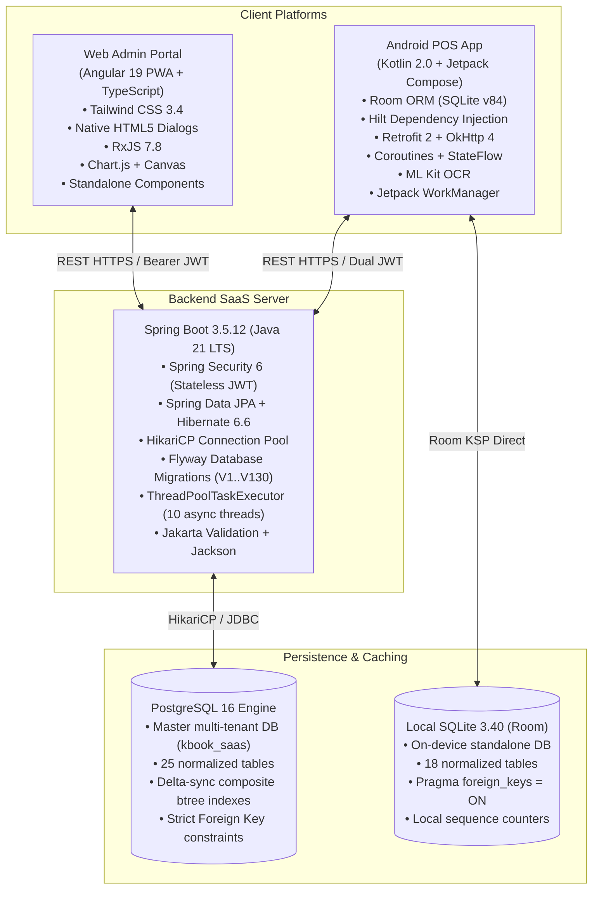
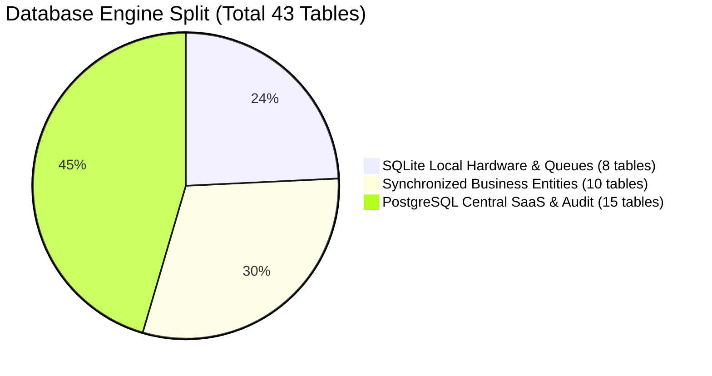

# 06 - System & Technical Architecture
> **KhanaBook SaaS Platform Discovery & Architecture Specification**  
> **Repository:** `/var/www/kbook.iadv.cloud`  
> **Document:** `docs/product-understanding/06-system-architecture.md`  
> **Status:** Active / Production  

---

## 1. Complete Technology Stack Matrix

---

## 2. Tier-by-Tier Architectural Specifications

### 2.1 Android POS Architecture (`apps/android/`)
- **Language & Runtime:** Kotlin 2.0 targeting Android SDK 34 (min SDK 24 — Android 7.0+).
- **Presentation Layer:** 100% Jetpack Compose (declarative reactive UI, zero legacy XML views). State managed via `StateFlow` and unidirectional data flow (MVI / MVVM).
- **Dependency Injection:** Dagger Hilt (`@HiltAndroidApp`, `@AndroidEntryPoint`, `@ViewModelScoped`).
- **Data & Persistence Layer:**
  - Room ORM v84 (`AppDatabase.kt`), wrapping Android SQLite with Kotlin Symbol Processing (KSP).
  - Explicit non-destructive migrations (`MIGRATION_30_31`, `MIGRATION_83_84`).
  - Thread containment: all Room queries run on `Dispatchers.IO`.
- **Background Synchronization:**
  - `SyncManager.kt`: Serialized sync engine governed by a single mutex (`syncMutex`).
  - Wrapped inside `withContext(NonCancellable)`: network pushes that receive server acknowledgments are guaranteed to persist their mapped IDs locally, even if the Android OS attempts to kill the process.
  - `SyncWorker.kt`: Jetpack WorkManager scheduled worker with `NetworkType.CONNECTED` constraints.
- **Hardware Integration:**
  - Native Bluetooth SPP (`BluetoothSocket`, RFCOMM).
  - Android USB Host API (`UsbManager`, bulk endpoint transfers).
  - Raw TCP network sockets (port `9100`) for LAN thermal printers.
  - Google ML Kit Text Recognition (`TextRecognizerOptions.DEFAULT_OPTIONS`) for offline menu card OCR scanning.

### 2.2 Web Admin Architecture (`apps/web-admin/`)
- **Framework:** Angular 19 (modern standalone components, signal-based reactivity, zero NgModules).
- **Styling & Tokens:** Tailwind CSS 3.4 with custom saffron/amber palette tokens defined in `tailwind.config.js`. Responsive breakpoints supporting desktop, tablet, and mobile browsers.
- **Dialog & Modal Subsystem:** Rebuilt in November 2026 to use **Native HTML5 `<dialog>` elements** (`showModal()`, `close()`) with custom backdrop filters, eliminating bulky third-party modal libraries and DOM memory leaks.
- **State Management & Communication:**
  - Scoped services utilizing RxJS `BehaviorSubject` and Angular Signals.
  - Central HTTP Error Interceptor (`error.interceptor.ts`) capturing 401 Unauthorized, 403 Forbidden, and 409 Conflict.
  - Role-based route protection via functional guards (`authGuard`, `roleGuard`).

### 2.3 Backend API Server Architecture (`services/server/`)
- **Runtime:** Java 21 LTS executing inside containerized OpenJDK runtime.
- **Framework:** Spring Boot 3.5.12.
- **Security & Multi-Tenancy:**
  - Stateless JWT authentication via `JwtFilter.java`.
  - Multi-tenancy achieved through ThreadLocal `TenantContext.java`. Every incoming HTTP request extracts `restaurantId` from the verified token and attaches it to the current thread.
  - All JPA repositories enforce tenant filtering: `@Query("SELECT e FROM Entity e WHERE e.restaurantId = :restaurantId")`.
- **Concurrency & Async Infrastructure:**
  - `ThreadPoolTaskExecutor` hardened in Session 019: configured with 10 core threads, 20 max threads, and a bounded queue of 500 tasks.
  - Non-blocking transaction design: Long-running or external network calls (WhatsApp Meta Cloud API, JavaMail SMTP, Firebase FCM push) are strictly annotated with `@Async` and executed **outside** of `@Transactional` boundaries, preventing HikariCP database connection pool starvation.
- **Database Connection Pool:**
  - HikariCP 5.1 with connection timeout of 30,000ms, max pool size of 20 connections per pod, leak detection threshold of 60,000ms, and validate query `SELECT 1`.
- **Flyway Database Migration Engine:**
  - 130 sequential database migrations (`V1__init.sql` through `V130__drop_misplaced_and_dead_profile_columns.sql`).
  - Automatic migration execution on Spring Boot startup with schema validation.

---

## 3. Database Architecture & Data Residency

### 3.1 Synchronized Business Entities (Dual-Residency)
These 10 entity pairs exist in both SQLite and PostgreSQL, synchronized via the delta sync engine:
1. `bills` ↔ `bills` (Orders, daily bill numbers, financial totals)
2. `bill_items` ↔ `bill_items` (Dish line items, quantities, rates)
3. `bill_payments` ↔ `bill_payments` (Tender records, cash/UPI splits)
4. `categories` ↔ `categories` (Menu sections and display ordering)
5. `menu_items` ↔ `menuitems` (Dishes, base pricing, food types, barcodes)
6. `item_variants` ↔ `itemvariants` (Portion sizes and rates)
7. `restaurant_profile` ↔ `restaurantprofiles` (Store branding, GSTIN, business hours)
8. `users` ↔ `users` (Staff accounts, encrypted PINs, roles)
9. `notifications` ↔ `notification_events` (Broadcast alerts)
10. `local_cashier_shifts` ↔ `cashier_shifts` (Cash drawer float shifts)

### 3.2 SQLite-Only Tables (Edge Hardware & Queues)
These 8 tables exist **exclusively on the Android terminal** and are NEVER pushed to PostgreSQL:
1. `printer_profiles`: Local hardware bindings (Bluetooth MAC, USB device IDs, IP addresses, paper widths).
2. `kitchen_print_queue`: Offline print spooler for failed or disconnected thermal printers.
3. `kot_events`: Immutable event-sourced audit log of all kitchen ticket prints and reprints.
4. `terminal_daily_counter`: Atomic local sequence generator for daily bill numbering.
5. `permission_cache`: Encrypted local copy of staff permissions for offline access gating.
6. `staff_permissions`: Local PIN hash verification table.
7. `sync_quarantine_records`: Dead-letter queue for sync payloads rejected by the server.
8. `menu_item_category_repairs`: Diagnostic self-healing table for orphaned local dishes.

### 3.3 PostgreSQL-Only Tables (Cloud Governance & Infrastructure)
These 15 tables exist **exclusively in the cloud database**:
1. `restaurant_terminals`: Master register of all hardware terminals (`A`..`E`) across all tenants.
2. `device_registration_request`: Fleet terminal pairing requests awaiting owner approval.
3. `device_tokens`: FCM registration tokens for remote silent sync wakeups.
4. `email_outbox`: Transactional email queue for PDF bills and daily summaries.
5. `feature_flag`: Platform-wide feature toggle catalog.
6. `feature_flag_override`: Per-restaurant feature flag overrides.
7. `feature_flag_audit`: Audit trail of feature flag modifications.
8. `menu_extraction_jobs`: Processing queue for AI/OCR menu digitisation.
9. `otp_requests`: Active and historical phone OTP verification records.
10. `rate_limit_attempts`: Brute-force protection counter for auth endpoints.
11. `refresh_tokens`: Long-lived session refresh tokens.
12. `token_blocklist`: Revoked JWT tokens for instant session termination.
13. `security_audit_logs`: Security event ledger (failed logins, refunds, owner actions).
14. `flyway_schema_history`: Flyway database version catalog (V1..V130).
15. `support_tickets`: Platform customer support tickets.

---

## 4. Testing & Verification Infrastructure

- **Backend Integration Tests:**
  - Real database integration tests using **Testcontainers (PostgreSQL 16 Alpine container)**:
    - `BillLifecycleSyncPostgresIntegrationTest.java`
    - `SourceChannelSyncContractTest.java`
    - `BillIdempotentUpsertTest.java`
    - `MultiDeviceInvoiceSyncIntegrationTest.java`
  - In-memory H2 tests for unit isolation: `MasterSyncStrictModeTest.java`, `BillPullStrictModeTest.java`.
- **Android Unit Tests:**
  - MockK + Robolectric + JUnit 4:
    - `InvoiceFormatterTest.kt` (Thermal receipt string formatting).
    - `PrintRouterTest.kt` (Hardware printer routing).
    - `VariantDraftReconcilerTest.kt` (In-place variant update planning).
    - `ValidationUtilsTest.kt` (GST and phone sanitization).
- **Code Quality & Security Gate:**
  - **OpenQodex Forensic Reviewer (`/root/.openqodex/bin/openqodex`)**: Automated git pre-push review scanner checking multi-tenant IDOR, `@Transactional` boundaries, and numeric type safety.
  - **Graphify Knowledge Graph**: AST code graph continuously indexing 18,590+ nodes, 51,100+ edges, and 1,030+ architectural communities.
