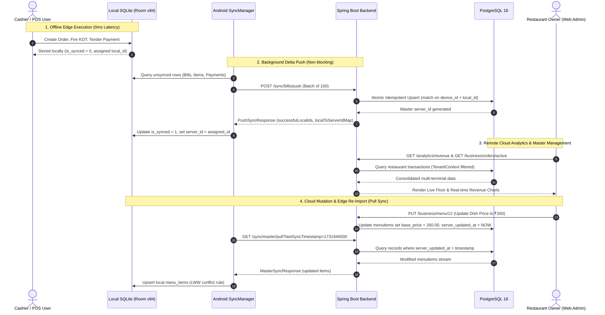
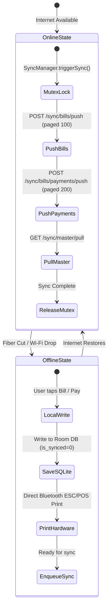

# 07 - Multi-Platform Data Flow & Sync Architecture
> **KhanaBook SaaS Platform Discovery & Architecture Specification**  
> **Repository:** `/var/www/kbook.iadv.cloud`  
> **Document:** `docs/product-understanding/07-platform-data-flow.md`  
> **Status:** Active / Production  

---

## 1. End-to-End Platform Data Flow Architecture

The distributed KhanaBook platform coordinates data across edge POS terminals, the central multi-tenant cloud server, and the web administration console.



---

## 2. Data Ownership & Residency Matrix

| Data Domain | Creator Platform | Consumer Platform | Authoritative Owner | Transfer API | Database Residency | Cached Locally? | Offline Behavior |
|---|---|---|---|---|---|:---:|---|
| **Bills & Orders** | Android POS | Android POS, Web Admin | **Android POS** (Local till) | `POST /sync/bills/push`<br/>`GET /sync/master/pull` | SQLite + PostgreSQL | Yes (Room) | Writes succeed 100% offline; queued for sync |
| **Bill Line Items** | Android POS | Android POS, Kitchen Printer | **Android POS** | `POST /sync/bills/items/push` | SQLite + PostgreSQL | Yes (Room) | Stored in SQLite; fired to KOT queue |
| **Bill Payments** | Android POS | Android POS, Web Admin | **Android POS** | `POST /sync/bills/payments/push` | SQLite + PostgreSQL | Yes (Room) | Full split payment saved offline |
| **KOT Slips & Print Jobs**| Android POS | Kitchen Printers | **Android POS (Edge)** | *None (Device-local)* | **SQLite Only** (`kot_events`) | Local Only | Printed via direct Bluetooth/USB/LAN |
| **Printer Hardware Setup**| Android POS | Android POS | **Android POS (Device)** | *None (Device-local)* | **SQLite Only** (`printer_profiles`) | Local Only | Retained locally; never synced to cloud |
| **Menu Catalog & Portions**| Web Admin or Android Owner | Android POS, Web Admin | **Cloud Server / Web** | `POST /business/menu`<br/>`GET /sync/master/pull` | SQLite + PostgreSQL | Yes (Room) | Existing menu usable offline; updates queue |
| **Store Profile & GST** | Android Owner or Web Admin | Android POS, Web Admin | **Cloud Server / Web** | `PUT /restaurants/profile`<br/>`GET /sync/master/pull` | SQLite + PostgreSQL | Yes (Room) | Local cached profile used for receipts |
| **Terminal Registrations** | Backend / Web Admin | Android POS | **Cloud Server** | `POST /sync/terminal/activate`<br/>`GET /business/terminals` | PostgreSQL (`restaurant_terminals`) | Token Only | Terminal operates under saved series token |
| **Staff & Permissions** | Web Admin | Android POS | **Cloud Server** | `POST /business/staff`<br/>`GET /sync/master/pull` | SQLite + PostgreSQL | Yes (Room) | 18 pinned permissions cached locally |
| **Daily Closing & Tills** | Web Admin | Web Admin | **Cloud Server** | `POST /analytics/daily-closing/submit` | PostgreSQL | No | Executed from Web Admin console |
| **Feature Flags** | Web Admin (Super Admin) | Backend, Web Admin | **Cloud Server** | `/admin/feature-flags/**` | PostgreSQL Only | No | In-memory cache on backend |

---

## 3. Delta Synchronization Protocol Details

### 3.1 Paged Batch Push Protocol
When `SyncManager` initiates a push:
1. **Dependency Sorting:** Records are pushed in strict relational order:
   $$\text{Categories} \longrightarrow \text{Menu Items} \longrightarrow \text{Variants} \longrightarrow \text{Bills} \longrightarrow \text{Bill Items} \longrightarrow \text{Bill Payments}$$
2. **Batch Chunking:**
   - Bills are chunked into pages of **100 records**.
   - Bill Items and Bill Payments are chunked into pages of **200 records**.
   - This prevents memory overflow on low-end Android POS terminals and eliminates HTTP request timeout freezes.
3. **Idempotency Guarantee:**
   - Every push payload includes `deviceId` and `localId`.
   - The server matches on composite unique constraint:
     $$\text{Unique Key} = (\text{restaurant\_id}, \text{device\_id}, \text{local\_id})$$
   - If a bill was previously accepted, the server skips duplicate insertion, updates the row if `updatedAt` is newer, and echoes back the existing `serverId`.
4. **Atomic Acknowledgment:**
   - The response payload returns:
     ```json
     {
       "successfulLocalIds": [1401, 1402, 1403],
       "failedLocalIds": [],
       "localToServerIdMap": {
         "1401": 89201,
         "1402": 89202,
         "1403": 89203
       }
     }
     ```
   - In SQLite, an atomic database transaction sets `is_synced = 1` and `server_id = :serverId` ONLY for the IDs in `successfulLocalIds`.
   - Any record modified locally *during* the sync roundtrip has its `is_synced` reset to 0 so it will be re-pushed in the next cycle.

### 3.2 Master Delta Pull Protocol
When the Android terminal requests updates:
1. Client sends: `GET /sync/master/pull?lastSyncTimestamp=1731940000`
2. Server queries:
   ```sql
   SELECT * FROM menuitems WHERE restaurant_id = :tenantId AND server_updated_at > :lastSyncTimestamp;
   SELECT * FROM categories WHERE restaurant_id = :tenantId AND server_updated_at > :lastSyncTimestamp;
   SELECT * FROM itemvariants WHERE restaurant_id = :tenantId AND server_updated_at > :lastSyncTimestamp;
   SELECT * FROM restaurantprofiles WHERE id = :tenantId AND server_updated_at > :lastSyncTimestamp;
   ```
3. Conflict Resolution Strategy: **Last-Write-Wins (LWW) with Immutable Paid Lock**:
   - Master data (menu, prices, shop config) applies the newest `server_updated_at` timestamp.
   - Financial transactions (bills): once a bill is marked `paid` or `cancelled`, it **cannot be reverted to draft** by a late-arriving offline push.

---

## 4. Resilience Under Network Failures



1. **Zero Billing Interruption:** The UI thread never awaits network calls. Local Room operations complete in <5 milliseconds.
2. **Power Loss Protection:** SQLite write-ahead logging (WAL) guarantees transactional ACID durability on device. If the tablet battery dies mid-order, the database recovers cleanly on boot.
3. **Quarantine Sandbox (`sync_quarantine_records`):** If a local record is rejected by the cloud server due to a malformed payload or permanent business logic violation, it is moved to `sync_quarantine_records` rather than blocking the rest of the sync pipeline. The till continues operating normally.
