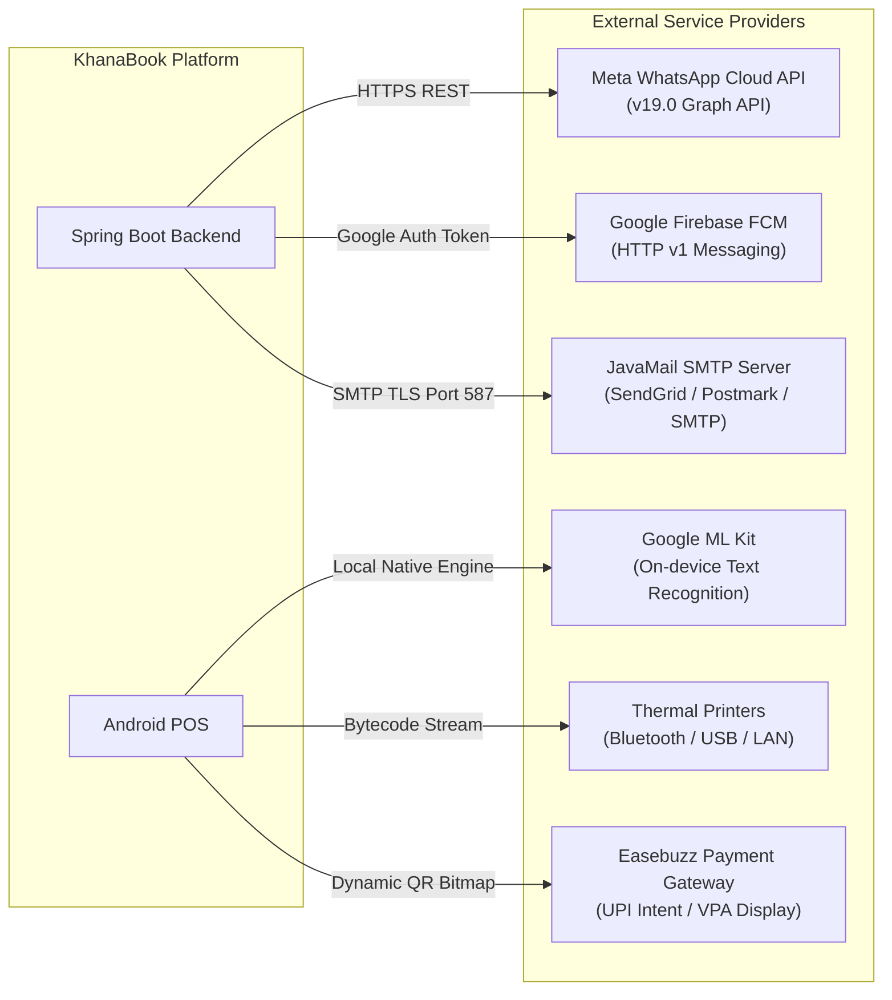

# 08 - API Inventory & External Integrations
> **KhanaBook SaaS Platform Discovery & Architecture Specification**  
> **Repository:** `/var/www/kbook.iadv.cloud`  
> **Document:** `docs/product-understanding/08-api-integration-inventory.md`  
> **Status:** Active / Production  

---

## 1. REST API Endpoint Catalog

The Spring Boot backend exposes a structured, multi-tenant REST API organized by domain families:

### 1.1 Authentication & Security APIs (`/auth/**`)
| Endpoint | Method | Role Allowed | Purpose | Request / Response Summary |
|---|:---:|:---:|---|---|
| `/auth/request-otp` | POST | Public | Send 6-digit OTP to mobile | `{ phone: "9876543210" }` → `{ success: true, retryAfter: 60 }` |
| `/auth/verify-otp` | POST | Public | Verify OTP & issue tokens | `{ phone: "...", otp: "123456" }` → `{ token, refreshToken, user, restaurantId }` |
| `/auth/login` | POST | Public | Password login for owners/admins | `{ loginId: "...", password: "..." }` → `{ token, refreshToken, role }` |
| `/auth/refresh` | POST | Public | Exchange refresh token | `{ refreshToken: "..." }` → `{ token: "new_jwt" }` |
| `/auth/logout` | POST | Authenticated | Revoke token | Adds incoming token JTI to `token_blocklist` |

### 1.2 Synchronization APIs (`/sync/**`)
| Endpoint | Method | Role Allowed | Purpose | Request / Response Summary |
|---|:---:|:---:|---|---|
| `/sync/terminal/activate` | POST | Authenticated | Register/activate POS hardware | Dual JWT check → `{ terminalSeries: "B", terminalToken: "..." }` |
| `/sync/bills/push` | POST | Owner, Staff | Batch push bills (100/page) | List of `BillSyncDto` → `PushSyncResponse` (success/failure maps) |
| `/sync/bills/items/push`| POST | Owner, Staff | Batch push line items (200/page)| List of `BillItemSyncDto` → `PushSyncResponse` |
| `/sync/bills/payments/push`| POST| Owner, Staff| Batch push payments (200/page)| List of `BillPaymentSyncDto` → `PushSyncResponse` |
| `/sync/menu/categories/push`| POST| Owner only | Push categories modified on POS | List of `CategorySyncDto` → `PushSyncResponse` |
| `/sync/menuitem/push` | POST | Owner only | Push menu items created on POS | List of `MenuItemSyncDto` → `PushSyncResponse` |
| `/sync/master/pull` | GET | Owner, Staff | Delta pull cloud updates | `?lastSyncTimestamp=epoch` → `MasterSyncResponse` |

### 1.3 Business Operations & Management APIs (`/business/**`)
| Endpoint | Method | Role Allowed | Purpose | Request / Response Summary |
|---|:---:|:---:|---|---|
| `/business/orders/active`| GET | Owner | Real-time Live Floor open tabs | Returns active bills with table numbers and timer |
| `/business/orders` | GET | Owner | Paginated order history | `?page=0&size=20&status=paid` → Paginated list of completed bills |
| `/business/bills/{id}` | GET | Owner | Detailed single bill inspection | Returns full bill with line items and payment splits |
| `/business/bills/{id}/manual-refund`| POST| Owner only | Process audited bill refund | `{ amount: 150.00, reason: "Defective item" }` → Updated bill |
| `/business/menu` | GET/POST | Owner | View / Create menu dishes | CRUD operations with image URLs and portion options |
| `/business/menu/categories`| GET/POST| Owner | Category list & reorder | Category hierarchy and display sort orders |
| `/business/menu/{id}/variants`| GET/POST| Owner | Portions setup (Half/Full) | Portion rate management |
| `/business/staff` | GET/POST | Owner | Manage cashier accounts | Staff listing, PIN assignment, and activation toggle |
| `/business/terminals` | GET | Owner | Terminal fleet listing | Active registered counters (`A`..`E`) with last-seen heartbeat |
| `/business/terminals/requests/{id}/approve`| POST| Owner only | Approve new counter terminal | Links hardware `deviceId` to terminal series letter |

### 1.4 Analytics & Closing APIs (`/analytics/**`)
| Endpoint | Method | Role Allowed | Purpose | Request / Response Summary |
|---|:---:|:---:|---|---|
| `/analytics/revenue` | GET | Owner | Revenue graphs and metrics | Total net sales, average order value, payment channel breakdown |
| `/analytics/gst-ledger` | GET | Owner | GST sales register | Taxable turnover, CGST, SGST, IGST totals by date range |
| `/analytics/daily-closing` | GET | Owner | Fetch expected till figures | Cash float, cash sales, cash refunds, net expected drawer cash |
| `/analytics/daily-closing/submit`| POST| Owner only | Commit end-of-day closing | `{ countedCash: 12500, variance: 0, notes: "..." }` → Closing receipt |

### 1.5 Platform Governance APIs (`/admin/**`)
| Endpoint | Method | Role Allowed | Purpose | Request / Response Summary |
|---|:---:|:---:|---|---|
| `/admin/businesses` | GET | KBook Admin | Master list of restaurant tenants | Tenant status, registered terminals, owner contact |
| `/admin/businesses/{id}/status`| PUT | KBook Admin | Suspend / activate tenant | `{ status: "SUSPENDED", reason: "Non-compliance" }` |
| `/admin/feature-flags` | GET/POST | KBook Admin | Platform feature toggles | Global and per-tenant feature flag switches |
| `/admin/system-health` | GET | KBook Admin | Server telemetry & pool metrics | HikariCP active connections, memory, JVM uptime |
| `/admin/notifications/send`| POST | KBook Admin | Broadcast announcement | Sends push notifications to active tenant devices |

---

## 2. External Third-Party Integrations

### 2.1 Meta WhatsApp Cloud API (v19.0)
- **Purpose:** Immediate delivery of digital e-invoices directly to customer WhatsApp chat upon bill settlement.
- **Connected Platform:** Spring Boot Backend (`services/server/`).
- **Data Exchanged:** Outgoing message payload containing:
  - Recipient phone number (E.164 format, e.g. `+919876543210`).
  - Template name: `bill_receipt_v1`.
  - Dynamic parameters: Restaurant name, customer bill number (`A15`), total amount (₹500.00), and short link (`https://kbook.iadv.cloud/invoice/E000015`).
- **Failure Handling:** Asynchronously dispatched via Spring `ThreadPoolTaskExecutor`. If Meta returns 4xx/5xx or rate limit, error is logged; database transaction is **never rolled back** (customer still receives physical thermal receipt).

### 2.2 Google Firebase Cloud Messaging (FCM HTTP v1)
- **Purpose:** Remote silent sync triggers and operational alerts to Android POS terminals.
- **Connected Platform:** Spring Boot Backend (`services/server/`) to Android POS (`apps/android/`).
- **Data Exchanged:** Silent push notifications with data payload:
  - `action`: `"SYNC_NOW"`
  - `entity`: `"MENU"` or `"TERMINAL_APPROVAL"`
  - `timestamp`: Epoch millisecond.
- **Failure Handling:** Token rotation managed via `device_tokens` table. Expired or uninstalled device tokens returned by Google are purged from the database automatically.

### 2.3 JavaMail Transactional SMTP Engine
- **Purpose:** Reliable delivery of password reset tokens, owner daily closing PDF summaries, and tax reports.
- **Connected Platform:** Spring Boot Backend (`services/server/`).
- **Data Exchanged:** HTML emails with embedded PDF invoice attachments.
- **Architecture:** Decoupled Outbox Pattern:
  - Application writes email payload to PostgreSQL `email_outbox` table within the business transaction.
  - Dedicated background scheduler (`ScheduledTasks.java`) polls pending emails, connects via SMTP over TLS, sends message, and marks status `SENT`.

### 2.4 ESC/POS Thermal Printer Protocol (Hardware)
- **Purpose:** High-speed physical paper receipts and Kitchen Order Tickets (KOT) at counters and kitchens.
- **Connected Platform:** Android POS (`apps/android/`).
- **Hardware Interfaces:**
  1. **Bluetooth SPP:** Direct RFCOMM connection using standard Serial Port Profile.
  2. **USB OTG:** Direct Android `UsbDeviceConnection` communicating with printer bulk transfer endpoints.
  3. **Ethernet / Wi-Fi LAN:** Direct socket connection to printer IP address on TCP port `9100`.
- **Data Exchanged:** Pure ESC/POS binary command stream:
  - Initialization: `0x1B 0x40` (ESC @)
  - Text Bold On/Off: `0x1B 0x45 0x01` / `0x1B 0x45 0x00`
  - Paper Cut: `0x1D 0x56 0x42 0x00` (GS V B 0)
  - Cash Drawer Kick: `0x1B 0x70 0x00 0x19 0xFA` (ESC p)

### 2.5 Google ML Kit On-Device OCR
- **Purpose:** Instant menu card digitisation via camera without cloud latency or third-party API fees.
- **Connected Platform:** Android POS (`apps/android/`).
- **Data Exchanged:** Android CameraX image frames analyzed locally by `TextRecognition.getClient(TextRecognizerOptions.DEFAULT_OPTIONS)`.
- **Implementation Status:** Fully operational on-device; runs with zero internet connectivity.

### 2.6 Easebuzz UPI Gateway Integration
- **Purpose:** Static and dynamic UPI QR code rendering for customer smartphone scanning.
- **Connected Platform:** Android POS (`apps/android/`) and Server (`services/server/`).
- **Operation Mode:** Direct VPA / Bharat QR formatting (`upi://pay?pa=:vpa&pn=:name&am=:amount&tr=:txnId`).
- **Status:** Operational for on-device QR generation and counter collection. Legacy sub-merchant escrow and webhook retry tables were intentionally purged in V129 to streamline operations.

---

## 3. Security, Timeouts & Secrets Handling

1. **Zero Hardcoded Credentials:** All third-party secrets (Meta Access Tokens, WhatsApp Phone Number ID, Firebase Service Account Keys, SMTP passwords) are strictly loaded via environment variables at container runtime (`WHATSAPP_TOKEN`, `FCM_SERVICE_KEY`, `MAIL_PASSWORD`).
2. **Circuit Breakers & Timeouts:** All outgoing HTTP client requests (Retrofit on Android, RestTemplate/WebClient on Server) enforce strict timeouts:
   - Connect Timeout: **5,000 ms**
   - Read Timeout: **10,000 ms**
3. **Audit Protection:** Security events (failed logins, terminal token generation, refund issuance) are recorded in `security_audit_logs`. Raw passwords, OTPs, and private keys are NEVER logged in plaintext.
