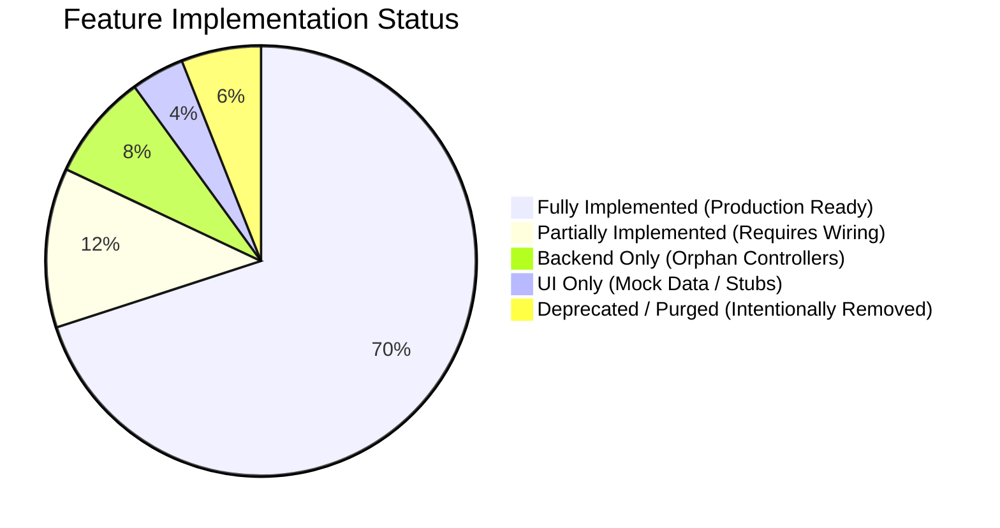

# 09 - Product Implementation Reality Check
> **KhanaBook SaaS Platform Discovery & Architecture Specification**  
> **Repository:** `/var/www/kbook.iadv.cloud`  
> **Document:** `docs/product-understanding/09-implementation-status.md`  
> **Status:** Active / Production  

---

## 1. Evidence-Based Feature Classification

Every capability in KhanaBook is verified against actual code, routes, database tables, and tests.

---

## 2. Exhaustive Implementation Reality Catalog

### 2.1 Fully Implemented Features (Working End-to-End)

#### 1. Multi-Terminal Offline Billing & Cart Engine
- **Status:** **FULLY IMPLEMENTED**
- **Evidence Files:**
  - Android UI: `apps/android/.../feature/billing/ui/NewBillScreen.kt`
  - Android Logic: `apps/android/.../feature/billing/viewmodel/CartManager.kt`
  - Android DB: `apps/android/.../core/database/AppDatabase.kt` (tables `bills`, `bill_items`, `terminal_daily_counter`)
  - Server Controller: `services/server/.../feature/sync/controller/MasterSyncController.java` (`POST /sync/bills/push`)
  - Server Service: `services/server/.../feature/billing/service/BillSyncService.java`
  - Server DB: PostgreSQL tables `bills`, `bill_items`
  - Unit Tests: `apps/android/.../feature/billing/domain/InvoiceFormatterTest.kt`, `services/server/.../sync/BillLifecycleSyncPostgresIntegrationTest.java`
- **Missing Pieces:** None. Fully operational in multi-counter environments.

#### 2. Split / Part Tendering (Cash + UPI)
- **Status:** **FULLY IMPLEMENTED**
- **Evidence Files:**
  - Android UI: `apps/android/.../feature/billing/ui/PaymentStep.kt`
  - Android Logic: `apps/android/.../feature/billing/viewmodel/PaymentStateManager.kt`
  - Android DB: `AppDatabase.kt` (table `bill_payments`, columns `part_amount_1`, `part_amount_2`)
  - Server Controller: `MasterSyncController.java` (`POST /sync/bills/payments/push`)
  - Server Service: `services/server/.../feature/billing/service/BillPaymentSyncService.java`
  - Server DB: PostgreSQL table `bill_payments`
  - Unit Tests: `services/server/.../sync/service/BillPaymentIdempotentUpsertTest.java`
- **Missing Pieces:** None. Split payments sync idempotently with operation UUIDs.

#### 3. Kitchen Order Ticket (KOT) & Thermal Print Spooler
- **Status:** **FULLY IMPLEMENTED**
- **Evidence Files:**
  - Android Logic: `apps/android/.../feature/printing/domain/KitchenTicketFormatter.kt`
  - Android Router: `apps/android/.../feature/printing/domain/PrintRouter.kt`
  - Android DB: `AppDatabase.kt` (tables `kot_events`, `kitchen_print_queue`, `printer_profiles`)
  - Unit Tests: `apps/android/.../feature/printing/domain/PrintRouterTest.kt`
- **Architectural Nuance:** Strictly device-local. Intentionally absent from PostgreSQL to prevent cloud latency from stalling kitchen preparation.

#### 4. Live Floor & Active Orders Monitoring
- **Status:** **FULLY IMPLEMENTED**
- **Evidence Files:**
  - Android UI: `apps/android/.../feature/billing/ui/ActiveOrdersScreen.kt`
  - Web Admin UI: `apps/web-admin/src/app/pages/orders/orders-page.component.ts` (Live Floor tab)
  - Server Controller: `services/server/.../feature/billing/controller/BillController.java` (`GET /business/orders/active`)
  - Server DB: PostgreSQL table `bills`
- **Missing Pieces:** None. Both web and Android display live tables and pending tabs.

#### 5. Menu Catalog, Portion Sizes & In-Place Reconciler
- **Status:** **FULLY IMPLEMENTED**
- **Evidence Files:**
  - Android UI: `apps/android/.../feature/menu/ui/MenuConfigurationScreen.kt`
  - Android Logic: `apps/android/.../feature/menu/ui/VariantDraftReconciler.kt`
  - Web Admin UI: `apps/web-admin/src/app/pages/menu/menu-page.component.ts`
  - Server Controller: `services/server/.../feature/menu/controller/MenuItemController.java`
  - Server DB: PostgreSQL tables `categories`, `menuitems`, `itemvariants`
  - Unit Tests: `apps/android/.../feature/menu/ui/VariantDraftReconcilerTest.kt`
- **Missing Pieces:** None. In-place variant updates eliminate deleted/re-added server rows.

#### 6. End-of-Day Daily Closing & Cash Drawer Balancing
- **Status:** **FULLY IMPLEMENTED**
- **Evidence Files:**
  - Web Admin UI: `apps/web-admin/src/app/pages/daily-closing/daily-closing-page.component.ts`
  - Server Controller: `services/server/.../feature/reports/controller/AnalyticsController.java` (`/analytics/daily-closing/**`)
  - Server Service: `services/server/.../feature/reports/service/DailyClosingService.java`
  - Server DB: PostgreSQL tables `bills`, `bill_payments`, `restaurantprofiles`
- **Missing Pieces:** None. Drawer balancing audits expected vs actual cash with full reporting.

#### 7. Terminal Fleet Governance & Series Letters
- **Status:** **FULLY IMPLEMENTED**
- **Evidence Files:**
  - Android Logic: `apps/android/.../feature/sync/domain/SyncManager.kt` (`ensureTerminalActivated`)
  - Web Admin UI: `apps/web-admin/src/app/pages/terminals/terminals-page.component.ts`
  - Server Controller: `services/server/.../feature/restaurants/controller/TerminalController.java`
  - Server DB: PostgreSQL tables `restaurant_terminals`, `device_registration_request`
  - Unit Tests: `services/server/.../sync/MasterSyncTerminalIsolationTest.java`
- **Missing Pieces:** None. Multi-terminal setups are strictly isolated to Series `A`..`E`.

#### 8. Branded Thermal Receipts & PDF Invoices
- **Status:** **FULLY IMPLEMENTED**
- **Evidence Files:**
  - Android Thermal: `apps/android/.../feature/billing/domain/InvoiceFormatter.kt`
  - Android PDF: `apps/android/.../feature/printing/domain/InvoicePDFGenerator.kt`
  - Server HTML: `services/server/.../feature/billing/controller/InvoiceController.java`
  - Verified Fix: Aligned `dailyOrderDisplay` (e.g. `A01`) across thermal and PDF outputs.
- **Missing Pieces:** None. 100% parity across thermal receipts and downloadable PDFs.

---

### 2.2 Partially Implemented Features (Operational with Constraints)

#### 1. Cashier Shift Float Management (`local_cashier_shifts`)
- **Status:** **PARTIALLY IMPLEMENTED (Schema Ready, UI Dormant)**
- **Evidence Files:**
  - Android Entity: `AppDatabase.kt` (table `local_cashier_shifts`, 25 columns)
  - Server Entity: `services/server/.../feature/shifts/data/CashierShift.java` (26 columns)
  - Server Controller: `CashierShiftController.java`
- **What is Working:** Full database tables, DAOs, DTOs, and sync mappers exist.
- **What is Missing:** The Android UI currently bypasses shift clock-in/clock-out gating. The store operates directly on restaurant-wide business hours Daily Closing without requiring cashiers to enter opening float notes.
- **Current Live Rows:** 0 rows in production database.

#### 2. Platform Admin Telemetry & Financial Routing (`/admin/**`)
- **Status:** **PARTIALLY IMPLEMENTED**
- **Evidence Files:**
  - Web Admin UI: `apps/web-admin/src/app/pages/platform-dashboard/`
  - Server Controllers: `AdminCommissionController.java`, `PaymentRoutingController.java`, `PaymentMetricsController.java`
- **What is Working:** Super Admin businesses list, feature flags, and system health are fully operational.
- **What is Missing:** The Commission and Payment Routing tabs in Web Admin contain static cards and mock statistics; they are not fully wired to real-time aggregations from `PaymentRoutingController`.

---

### 2.3 Backend-Only / Orphan Capabilities (No Client UI)

The following 5 Spring Boot controller families exist on the server, but have zero corresponding call sites in `apps/android` or `apps/web-admin`:
1. `/business/tax/**` (`TaxComplianceController.java`): Automated GST return file generation.
2. `/business/customers/**` (`CustomerDataController.java`): Customer data export and GDPR/DPDP data erasure.
3. `/business/financing/**` (`FinancingController.java`): Merchant working capital loan offers.
4. `/business/commerce/**` (`UnifiedCommerceController.java`): Omnichannel catalog sync stubs.
5. `/business/onboarding/**` (`OnboardingController.java`): Legacy merchant document flow.
- **Architectural Status:** These orphan controllers represent future roadmap features or legacy prototypes. They do not impair active POS billing or web console operations.

---

### 2.4 Deprecated & Purged Features (Intentionally Removed)

| Feature | Deprecation Version | Reason for Removal |
|---|:---:|---|
| **Subscription Paywalls & Plans** | Flyway V124 | KhanaBook transitioned to 100% Free Lifetime Tier. Tables `subscription_plans` and `restaurant_subscriptions` were dropped. |
| **Custom Staff Permission Overrides**| Flyway V124 | Replaced by immutable 18-action role set (`SHOP_STAFF`). Tables `staff_permissions`, `role_templates`, `permission_requests` dropped. |
| **Marketplace Order Sync (Zomato/Swiggy)**| Flyway V123/V125| Dropped third-party marketplace tables to eliminate bloat and focus exclusively on high-speed direct on-premise dining. |
| **Dormant Raw-Material CRM Tables** | Flyway V127 | Dropped 7 unused inventory and vendor CRM tables that had zero active usage. |
| **FSSAI Compliance Renewal Tracking** | Flyway V128 | Dropped standalone FSSAI tracking tables; expiry date consolidated directly into `restaurantprofiles`. |
| **Easebuzz Sub-Merchant Escrow Tables**| Flyway V129 | Purged complex sub-merchant escrow and webhook retry tables in favor of direct merchant UPI QR payment collection. |
