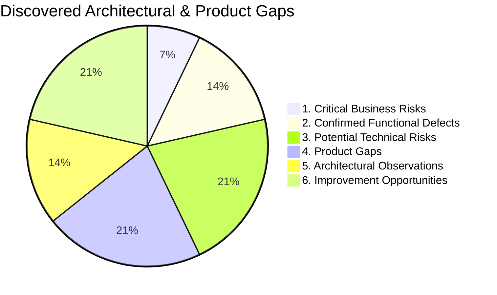

# 10 - Product Gaps & Architectural Risks
> **KhanaBook SaaS Platform Discovery & Architecture Specification**  
> **Repository:** `/var/www/kbook.iadv.cloud`  
> **Document:** `docs/product-understanding/10-product-gaps-and-risks.md`  
> **Status:** Active / Production  

---

## 1. Executive Risk & Gap Overview

Every observation in this document is grounded in concrete forensic evidence discovered in the codebase, database schemas, or runtime architecture.

---

## 2. Classified Risk & Gap Findings

### Category 1: Critical Business Risk
#### Risk 1.1: Single Central Database Without Multi-Region Read Replicas
- **Classification:** **Critical Business Risk**
- **Evidence:** `services/server/src/main/resources/application.properties` connects all write and read queries to a single PostgreSQL 16 master instance via HikariCP (`jdbc:postgresql://localhost:5432/kbook_saas`).
- **Impact:** While Android POS terminals continue billing offline during cloud outages, the Web Admin console, remote revenue visibility, and sync ingestion halt if the single database server experiences hardware failure.
- **Mitigation Recommendation:** Configure streaming replication with an automated read replica and daily automated pg_dump snapshots to offsite cloud storage.

---

### Category 2: Confirmed Functional Defects
#### Defect 2.1: Secondary Restaurant Switch on Same Physical Install Blocked by Terminal Activation
- **Classification:** **Confirmed Functional Defect**
- **Evidence:**
  - `TerminalController.java` (`services/server/.../feature/restaurants/controller/TerminalController.java`)
  - `SessionManager.kt` (`apps/android/.../feature/auth/domain/SessionManager.kt`)
- **Symptom:** If a store owner manages two restaurants (Outlet 1 and Outlet 2) and signs out of Outlet 1 to log into Outlet 2 on the same Android tablet, the login succeeds but billing is blocked by `TerminalPendingApprovalException` (HTTP 202).
- **Root Cause:** The server activates a device automatically only if it is the *first device* registered to that restaurant. Since Outlet 2 already has Counter A registered, the device is queued into `device_registration_request` awaiting an approval that nobody executes.
- **Fix Recommendation:** When the authenticated user has role `OWNER`, allow immediate counter reassignment or automated terminal series binding for multi-tenant owners.

#### Defect 2.2: Category Drag-and-Drop Reordering Conflict on App Restart
- **Classification:** **Confirmed Functional Defect**
- **Evidence:** `CategoryRepository.kt` (`apps/android/.../feature/menu/data/CategoryRepository.kt`) and `GenericSyncService.java`.
- **Symptom:** Drag-reordering menu categories on Android updates the display during the active session, but reverts back to server order after app restart.
- **Root Cause:** Reordering bumps `updatedAt` for every category row. During push, the server optimistic locking rejects concurrent changes with 409 Conflict. The recovery mechanism pulls with `lastSyncTimestamp = 0`, overwriting the local order with the server's previous ordering.
- **Fix Recommendation:** Use deterministic fractional index sorting or a single dedicated category reorder API payload rather than row-by-row concurrent entity pushes.

---

### Category 3: Potential Technical Risks
#### Risk 3.1: Large Offline Unsynced Transaction Queue Memory Pressure
- **Classification:** **Potential Technical Risk**
- **Evidence:** `SyncManager.kt` (`apps/android/.../feature/sync/domain/SyncManager.kt`).
- **Symptom:** If a POS terminal operates offline for 4–5 days during an extended festival or network failure, hundreds of bills accumulate in SQLite.
- **Status:** Mitigated in recent commits by chunking pushes into pages of **100 bills** and **200 items/payments**.
- **Residual Risk:** If network latency is high and timeout occurs mid-page, partial acknowledgments require careful reconciliation to ensure child `bill_items` are not orphaned before their parent bill is acknowledged.

#### Risk 3.2: Local Wall-Clock Skew on POS Devices
- **Classification:** **Potential Technical Risk**
- **Evidence:** `BillSyncService.java` enforces a 5-minute clock-skew boundary against server time.
- **Impact:** If an Android tablet's internal clock drifts by more than 15 minutes (e.g. tablet battery drains completely and resets to Jan 1, 1970), delta sync timestamps and daily business hour boundaries become distorted.
- **Mitigation Recommendation:** Synchronize terminal business date and time with the server's HTTP `Date` header on every network handshake.

#### Risk 3.3: HikariCP Connection Pool Starvation Under Heavy Concurrent Pushes
- **Classification:** **Potential Technical Risk**
- **Evidence:** `services/server/src/main/resources/application.properties` allocates 20 maximum connections.
- **Status:** Partially mitigated in Session 019 by moving Meta WhatsApp API, JavaMail SMTP, and FCM push outside of `@Transactional` methods.
- **Residual Risk:** If 50+ counter terminals push large backlogs simultaneously, the 20-connection pool could queue.
- **Mitigation Recommendation:** Scale HikariCP max pool size to 35 connections and ensure sync batch transactions commit in <25ms.

---

### Category 4: Product Gaps
#### Gap 4.1: Dormant Cashier Shift Float Workflow (`local_cashier_shifts`)
- **Classification:** **Product Gap**
- **Evidence:** Table `local_cashier_shifts` (25 columns) and server entity `CashierShift.java` exist in schema with 0 live records.
- **Impact:** The system currently relies on restaurant-wide Daily Closing. Individual cashiers do not declare an opening cash drawer float or close individual till shifts when handing over to the next shift cashier.
- **Opportunity:** Wire the existing shift entities to a 2-step Cashier Shift dialog on Android POS (Float In at start, Drawer Drop at end).

#### Gap 4.2: Lack of Graphical Table Layout Floor Map
- **Classification:** **Product Gap**
- **Evidence:** `ActiveOrdersScreen.kt` displays active orders as a grid of cards (`Table: T4`, `Table: T7`).
- **Impact:** Fine dining and casual restaurants prefer a visual drag-and-drop floor plan showing physical table shapes, sections (AC Hall, Rooftop, Garden), and seating occupancy.
- **Mitigation Recommendation:** Introduce an optional Floor Map view mode in `ActiveOrdersScreen.kt`.

#### Gap 4.3: Five Orphan Server Controller Families
- **Classification:** **Product Gap**
- **Evidence:** Five controllers (`TaxComplianceController`, `CustomerDataController`, `FinancingController`, `UnifiedCommerceController`, `OnboardingController`) have zero client call sites.
- **Impact:** Dead code cluttering server surface area.
- **Mitigation Recommendation:** Formally deprecate and remove orphan stubs or expose them via dedicated web admin tabs (e.g., GST GSTR-1 direct download on the Reports page).

---

### Category 5: Architectural Observations
#### Observation 5.1: 100% Free Lifetime Tier Transformation
- **Classification:** **Architectural Observation**
- **Evidence:** Flyway migration V124 permanently dropped `subscription_plans` and `restaurant_subscriptions`.
- **Finding:** The platform has successfully eliminated recurring paywalls. All POS features, multi-terminal sync, and reporting are free for restaurant owners. Future monetization will center on value-add fintech (instant settlement, payment gateway commissions, loan originations) rather than basic software licensing.

#### Observation 5.2: Hardware Isolation Success
- **Classification:** **Architectural Observation**
- **Evidence:** `printer_profiles` table lives purely in local SQLite; `SettingsViewModel.savePrinterSettingsLocally` saves settings without resetting `is_synced = 0`.
- **Finding:** Bluetooth MAC addresses and USB device bindings on Counter A never clobber Counter B through cloud sync.

---

### Category 6: Improvement Opportunities
1. **Local P2P Wi-Fi Sync:** Implement Android Wi-Fi Direct / Local mDNS LAN synchronization so multiple counters can see each other's open tabs even during a multi-day total internet blackout.
2. **Direct GSTR-1 Government Portal Filing:** Utilize the existing `/analytics/gst-ledger` data to export JSON in the exact schema required by the Indian GST Offline Tool.
3. **Kitchen Display System (KDS) PWA:** Provide a lightweight web screen for kitchen displays, supplementing physical thermal KOT paper slips.
