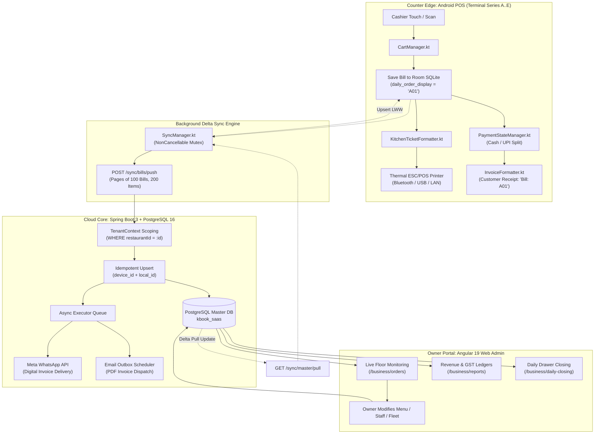

# 11 - Complete Product Map & Architecture Cross-Reference
> **KhanaBook SaaS Platform Discovery & Architecture Specification**  
> **Repository:** `/var/www/kbook.iadv.cloud`  
> **Document:** `docs/product-understanding/11-complete-product-map.md`  
> **Status:** Active / Production  

---

## 1. Master Cross-Platform Connectivity Map

This unified matrix maps every capability across all tiers: **Platform → Module → Feature → Allowed Roles → UI Screen → API Endpoint → Backend Service → Database Tables**.

| Platform | Module | Feature | Allowed Roles | UI Screen / Route | API Endpoint | Backend Service | Database Tables Involved |
|---|---|---|---|---|---|---|---|
| **Android POS** | Billing | Order Creation & Cart | `OWNER`, `SHOP_STAFF` | `NewBillScreen.kt` `Routes.NEW_BILL` | *Local execution* | `CartManager.kt` `BillingViewModel.kt` | SQLite: `bills`, `bill_items`, `terminal_daily_counter` |
| **Android POS** | Billing | Split / Part Tendering | `OWNER`, `SHOP_STAFF` | `PaymentStep.kt` | *Local execution* | `PaymentStateManager.kt` | SQLite: `bills`, `bill_payments` |
| **Android POS** | Billing | Delta Sync Push | System / Auto | *Background* | `POST /sync/bills/push` `POST /sync/bills/items/push` `POST /sync/bills/payments/push` | `GenericSyncService.java` `BillSyncService.java` `BillPaymentSyncService.java` | SQLite: `bills`, `bill_items`, `bill_payments` PostgreSQL: `bills`, `bill_items`, `bill_payments` |
| **Android POS** | Kitchen | KOT Thermal Print | `OWNER`, `SHOP_STAFF` | `KitchenTicketFormatter.kt` | *Local execution* | `PrintRouter.kt` `PrintQueueManager.kt` | SQLite: `kot_events`, `kitchen_print_queue`, `printer_profiles` |
| **Android POS** | Kitchen | KOT Ticket Reprint | `OWNER`, `SHOP_STAFF` | `ReprintKdsScreen.kt` `Routes.REPRINT_KOT` | *Local execution* | `PrintRouter.kt` | SQLite: `kot_events`, `printer_profiles` |
| **Android POS** | Operations | Live Floor / Tabs | `OWNER`, `SHOP_STAFF` | `ActiveOrdersScreen.kt` `Routes.ACTIVE_ORDERS` | *Local execution* | `BillingViewModel.kt` | SQLite: `bills` (where `payment_status = 'pending'`) |
| **Android POS** | Reports | Terminal Day Summary | `OWNER`, `SHOP_STAFF` | `ReportsScreen.kt` (Tab: Day Summary) | *Local execution* | `ReportsViewModel.kt` | SQLite: `bills`, `bill_payments` |
| **Android POS** | Menu | Portions & Portions Edit | `OWNER` | `MenuConfigurationScreen.kt` | `POST /business/menu` `POST /sync/menuitem/push` | `MenuRepository.kt` `VariantDraftReconciler.kt` | SQLite: `categories`, `menu_items`, `item_variants` PostgreSQL: `categories`, `menuitems`, `itemvariants` |
| **Android POS** | Menu | Barcode Camera Scanner | `OWNER`, `SHOP_STAFF` | `OcrScannerScreen.kt` `Routes.OCR_SCANNER` | *Local execution* | `CartManager.kt` (`handleScannedBarcode`) | SQLite: `menu_items` (barcode lookup) |
| **Android POS** | Menu | AI / OCR Menu Scan | `OWNER` | `OcrScannerScreen.kt` | *Local ML Kit* | `OcrComponents.kt` | SQLite: `menu_items`, `categories` |
| **Android POS** | Hardware | Printer Hardware Config | `OWNER`, `SHOP_STAFF` | `SettingsScreen.kt` (Printers Tab) | *Local execution* | `SettingsViewModel.kt` `PrintRouter.kt` | SQLite: `printer_profiles` (Bluetooth MAC, USB ID, LAN IP) |
| **Android POS** | Settings | Store Branding & Hours | `OWNER` | `SettingsScreen.kt` (Profile Tab) | `PUT /restaurants/profile` | `RestaurantProfileRepository.kt` | SQLite: `restaurant_profile` PostgreSQL: `restaurantprofiles` |
| **Android POS** | Auth | Terminal Activation | `OWNER`, `SHOP_STAFF` | `InitialSyncScreen.kt` `Routes.DEVICE_SETUP` | `POST /sync/terminal/activate` | `TerminalController.java` `TerminalOwnershipService.java`| PostgreSQL: `restaurant_terminals`, `device_registration_request` |
| **Web Admin** | Operations | Live Floor Management | `OWNER` | `OrdersPageComponent` `/business/orders` (Live Floor) | `GET /business/orders/active` | `BillController.java` | PostgreSQL: `bills`, `bill_items` |
| **Web Admin** | Operations | Completed Order History | `OWNER` | `OrdersPageComponent` `/business/orders` (History Tab) | `GET /business/orders` | `BillController.java` | PostgreSQL: `bills`, `bill_items`, `bill_payments` |
| **Web Admin** | Operations | Customer Bill Refund | `OWNER` | `OrdersPageComponent` (Refund Modal) | `POST /business/bills/{id}/manual-refund`| `BillController.java` `SecurityAuditService.java` | PostgreSQL: `bills`, `bill_payments`, `security_audit_logs` |
| **Web Admin** | Menu | Category CRUD & Reorder | `OWNER` | `MenuPageComponent` `/business/menu` | `GET /business/menu/categories` `POST /business/menu/categories` | `CategoryController.java` | PostgreSQL: `categories` |
| **Web Admin** | Menu | Dish & Variant CRUD | `OWNER` | `MenuPageComponent` `/business/menu` | `GET /business/menu` `POST /business/menu` | `MenuItemController.java` `ItemVariantController.java` | PostgreSQL: `menuitems`, `itemvariants` |
| **Web Admin** | Reports | Business Sales Overview | `OWNER` | `ReportsPageComponent` `/business/reports` (Overview) | `GET /analytics/revenue` | `AnalyticsController.java` | PostgreSQL: `bills`, `bill_payments` |
| **Web Admin** | Reports | GST Sales Ledger & CSV | `OWNER` | `ReportsPageComponent` `/business/reports` (GST Tab) | `GET /analytics/gst-ledger` `GET /analytics/gst-ledger/csv` | `AnalyticsController.java` | PostgreSQL: `bills`, `bill_items` |
| **Web Admin** | Closing | End-of-Day Till Closing | `OWNER` | `DailyClosingPageComponent` `/business/daily-closing` | `GET /analytics/daily-closing` `POST /analytics/daily-closing/submit`| `AnalyticsController.java` `DailyClosingService.java` | PostgreSQL: `bills`, `bill_payments`, `restaurantprofiles` |
| **Web Admin** | Staff | Staff User CRUD | `OWNER` | `StaffPageComponent` `/business/staff` | `GET /business/staff` `POST /business/staff` | `UserController.java` `PermissionService.java` | PostgreSQL: `users` |
| **Web Admin** | Terminals | Fleet Approval & Series | `OWNER` | `TerminalsPageComponent` `/business/terminals` | `GET /business/terminals` `POST /business/terminals/requests/{id}/approve` | `TerminalManagementController.java` | PostgreSQL: `restaurant_terminals`, `device_registration_request` |
| **Web Admin** | Settings | Business Profile & Hours | `OWNER` | `BusinessSettingsPageComponent` `/business/settings` | `GET /restaurants/profile` `PUT /restaurants/profile` | `RestaurantProfileController.java` | PostgreSQL: `restaurantprofiles` |
| **Web Admin** | SaaS Admin | Tenant Businesses List | `KBOOK_ADMIN` | `BusinessesPageComponent` `/admin/businesses` | `GET /admin/businesses` `PUT /admin/businesses/{id}/status` | `BusinessAdminController.java` | PostgreSQL: `restaurantprofiles` |
| **Web Admin** | SaaS Admin | Platform Feature Flags | `KBOOK_ADMIN` | `FeatureFlagsPageComponent` `/admin/feature-flags` | `GET /admin/feature-flags` `POST /admin/feature-flags` | `FeatureFlagAdminController.java` | PostgreSQL: `feature_flag`, `feature_flag_override`, `feature_flag_audit`|
| **Web Admin** | SaaS Admin | System Health & Pools | `KBOOK_ADMIN` | `SystemHealthPageComponent` `/admin/system-health` | `GET /admin/system-health` | `SystemHealthController.java` | PostgreSQL: In-memory HikariCP + JVM stats |
| **Cloud Worker**| Outbox | Async Email Delivery | System / Auto | *Background Scheduler* | *SMTP Port 587* | `ScheduledTasks.java` `EmailOutboxService.java` | PostgreSQL: `email_outbox` |
| **Cloud Worker**| Delivery | WhatsApp Digital Bill | System / Auto | *Async Executor* | `POST https://graph.facebook.com/...` | `SyncNotificationService.java` | PostgreSQL: `bills`, `restaurantprofiles` |

---

## 2. Product Architecture Flowchart

