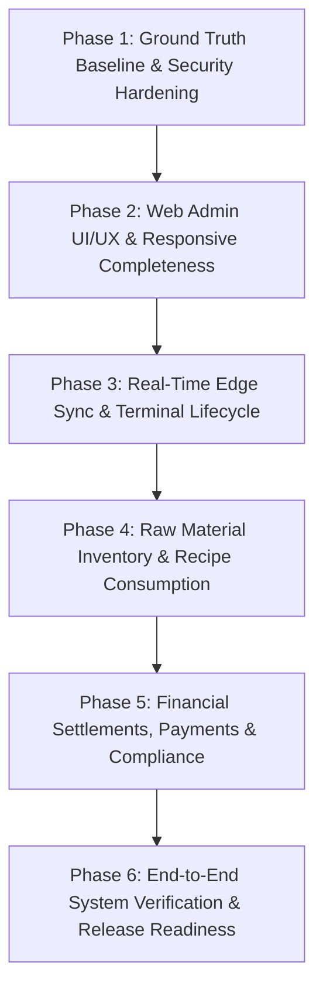

# KhanaBook — Production Implementation Plan (IMPLEMENTATION_PLAN.md)

**Document Version:** 1.0.0  
**Status:** Approved Engineering Roadmap & Execution Plan  
**Sources of Truth:** [`PRD.md`](file:///C:/Users/nandh/Desktop/Khanabook/KhanaBook/PRD.md), [`DESIGN.md`](file:///C:/Users/nandh/Desktop/Khanabook/KhanaBook/DESIGN.md), [`ARCHITECTURE.md`](file:///C:/Users/nandh/Desktop/Khanabook/KhanaBook/ARCHITECTURE.md), [`DATABASE.md`](file:///C:/Users/nandh/Desktop/Khanabook/KhanaBook/DATABASE.md), [`API.md`](file:///C:/Users/nandh/Desktop/Khanabook/KhanaBook/API.md), [`AGENTS.md`](file:///C:/Users/nandh/Desktop/Khanabook/KhanaBook/AGENTS.md)  
**Target Monorepo:** `apps/web-admin` (Angular 18.2.0), `apps/android` (Kotlin Compose, Room v82), `services/server` (Spring Boot 3.5.12, Java 17)  

---

## 1. Plan Overview & Execution Principles

This implementation plan organizes all development and hardening tasks into ordered, logically decoupled phases. Every phase establishes foundational reliability before dependent features are implemented, enforces strict verification via automated tests, and adheres strictly to the approved architectural invariants.

---

## 2. Phased Implementation Roadmap

---

### Phase 1: Ground Truth Baseline & Security Hardening

#### Goal
Enforce strict multi-tenant isolation, session security, and the 3-role surface boundary (`OWNER`, `SHOP_STAFF`, `KBOOK_ADMIN`) across all backend API controllers and frontend route guards.

#### Tasks
1. **Task 1.1: Web Admin Login Surface Boundary Verification**
   * Ensure `/auth/login` payload passes `{ surface: 'web' }` consistently across all auth flows.
   * Verify server-side rejection (`403 Forbidden`, `STAFF_WEB_ACCESS_DENIED`) when an account with role `SHOP_STAFF` attempts to authenticate via Web Admin.
2. **Task 1.2: Multi-Tenant Scoping Audit in JPA Repositories**
   * Audit all queries in `services/server/src/main/java/com/khanabook/saas/**/repository/` to guarantee `restaurant_id` is validated against the authenticated JWT security context.
   * Ensure no direct object ID lookups allow cross-tenant data leakage.
3. **Task 1.3: Refresh Token Revocation & Expiry Hardening**
   * Ensure `POST /auth/logout` revokes the token in `refresh_tokens`.
   * Verify `POST /business/staff/:userId/revoke-sessions` and `POST /business/sessions/revoke-all` invalidate active tokens immediately.

#### Affected Modules & Files
* `services/server/.../feature/auth/controller/AuthController.java`
* `services/server/.../feature/auth/service/AuthenticationService.java`
* `services/server/.../core/security/JwtAuthenticationFilter.java`
* `apps/web-admin/src/app/core/auth/auth.service.ts`
* `apps/web-admin/src/app/core/auth/auth.guard.ts`

#### Dependencies / Prerequisites
* PostgreSQL database connected with Flyway migrations up to `V117`.
* Node.js & Angular test runners configured.

#### Database / API Changes
* Ensure index `idx_users_restaurant_role` and `uq_refresh_tokens_token` are active.
* Verify endpoint `POST /auth/login` response envelope adheres to `API.md` Section 2.1.

#### Tests Required
* `mvn test -Dtest=AuthControllerTest` (Verify `SHOP_STAFF` rejection on web surface).
* `mvn test -Dtest=JwtSecurityContextTest` (Verify multi-tenant token extraction).
* `npm test -- --watch=false --browsers=ChromeHeadless` in `apps/web-admin` (Auth guard tests).

#### Completion Criteria
* `SHOP_STAFF` cannot log into Web Admin under any circumstance.
* Token revocation immediately blocks subsequent API requests with `401 Unauthorized`.
* All auth tests pass 100%.

---

### Phase 2: Web Admin UI/UX & Responsive Completeness

#### Goal
Verify all 12 operational Web Admin views against the design system rules in [`DESIGN.md`](file:///C:/Users/nandh/Desktop/Khanabook/KhanaBook/DESIGN.md), ensuring zero horizontal scrolling on mobile viewports (375×812), high-contrast accessibility (WCAG 2.1 AA), uniform table row heights (~52px), and responsive modal sizing.

#### Tasks
1. **Task 2.1: Navigation Shell & Mobile Drawer Interaction**
   * Audit `layout/sidebar` and ensure the mobile hamburger drawer container uses `z-index: 100` with backdrop `z-index: 99`.
   * Verify backdrop tap closes drawer immediately and prevents pointer-event lockup.
2. **Task 2.2: Table Row Height & Action Stack Regularization**
   * Inspect all `.table-wrap table` implementations across Orders, Menu, Staff, and Terminals.
   * Ensure all `.action-stack` elements specify `white-space: nowrap; flex-wrap: nowrap; display: flex; align-items: center;` maintaining ~`52px` row height.
3. **Task 2.3: Form Modals & Physical Address Input Safety**
   * Verify all modal dialogs apply `max-height: min(88vh, 760px); overflow-y: auto;` with sticky header and fixed bottom actions.
   * Ensure business address inputs use `<textarea rows="3">` with `min-height: 72px; resize: vertical;`.
4. **Task 2.4: Accessibility & Contrast Verification (WCAG 2.1 AA)**
   * Audit all `.toggle-btn--on` active states (guarantee `#ffffff` on `#0066cc`, contrast 8.59:1).
   * Ensure disabled buttons use neutral `#e5e7eb` background with `#9ca3af` text.
   * Verify skip link (`"Skip to main content"`) is accessible via keyboard navigation.

#### Affected Modules & Files
* `apps/web-admin/src/app/layout/sidebar/`
* `apps/web-admin/src/app/pages/orders/`
* `apps/web-admin/src/app/pages/menu/`
* `apps/web-admin/src/app/pages/staff/`
* `apps/web-admin/src/app/pages/terminals/`
* `apps/web-admin/src/app/pages/business-profile/`
* `apps/web-admin/src/styles/` (`tokens.scss`, `components.scss`, `tables.scss`)

#### Dependencies / Prerequisites
* Completion of Phase 1 (Authenticated session to render protected routes).

#### Database / API Changes
* None (Frontend UI/UX formatting & styling only).

#### Tests Required
* `npm test -- --watch=false --browsers=ChromeHeadless` in `apps/web-admin` (All 207+ tests passing).
* Visual confirmation across 1440×900 and 375×812 viewports.

#### Completion Criteria
* Zero horizontal overflow on 375px mobile screens.
* No table row ballooning beyond ~52px.
* Modals fit comfortably on laptop screens without hiding save/action buttons.

---

### Phase 3: Real-Time Edge Sync & Terminal Lifecycle

#### Goal
Harden the edge-to-cloud synchronization loop (`/sync/push` and `/sync/pull`) between the Android POS client (Room Schema v82) and the cloud backend (`BaseSyncEntity`), ensuring conflict resolution, monotonic status protection, and reliable terminal provisioning.

#### Tasks
1. **Task 3.1: Hardware Terminal Provisioning & Pairing Workflow**
   * Enforce terminal approval handshake: Android device submits registration request (`POST /business/terminal-requests`).
   * Owner approves request in Web Admin (`POST /business/terminal-requests/:id/approve`), assigning `terminalSeries` (e.g. `A`, `B`).
   * Device stores `terminalSeries` locally in Room DB and uses it for bill numbering: `KB-{RestaurantId}-{TerminalSeries}-{FY}-{Seq}`.
2. **Task 3.2: Edge Push Sync & State Protection (`POST /sync/push`)**
   * Ensure Android `SyncWorker` correctly packages un-synced `BaseSyncEntity` batches (`bills`, `bill_items`, `bill_payments`).
   * Verify `BillSyncService.protectBillState` uses `status_version` monotonic counters so intentional offline edits are never overwritten by stale pushes.
3. **Task 3.3: Delta Pull Sync (`POST /sync/pull`)**
   * Implement incremental pull for modified `menuitems`, `categories`, and `restaurantprofiles` where `updated_at > :since`.
   * Ensure edge merges delta updates in a single local Room transaction.
4. **Task 3.4: SQLCipher Edge Security & Migration Integrity**
   * Verify Room Database encrypted at rest using SQLCipher via `DatabaseProvider.kt` with DB name `khanabook_lite_db_<restaurantId>`.
   * Validate all 17 Room entities pass `DatabaseMigrationListConsistencyTest.kt`.

#### Affected Modules & Files
* `services/server/.../feature/sync/controller/MasterSyncController.java`
* `services/server/.../feature/sync/service/GenericSyncService.java`
* `services/server/.../feature/billing/service/BillSyncService.java`
* `services/server/.../feature/restaurants/service/TerminalManagementService.java`
* `apps/android/.../core/database/AppDatabase.kt`
* `apps/android/.../core/database/DatabaseProvider.kt`
* `apps/android/.../feature/sync/SyncWorker.kt`

#### Dependencies / Prerequisites
* Completion of Phase 1 (Auth & Multi-Tenant Scoping).

#### Database / API Changes
* Unique constraint `uq_restaurant_terminal_series` on `restaurant_terminal (restaurant_id, terminal_series)`.
* Unique constraint `(restaurant_id, device_id, local_id)` on all synced tables.

#### Tests Required
* `mvn test -Dtest=BillSyncServiceTest` (Verify monotonic `status_version` protection).
* `mvn test -Dtest=TerminalManagementServiceTest` (Verify terminal registration & series allocation).
* `./gradlew.bat testDebugUnitTest` in `apps/android/` (Room migration consistency).

#### Completion Criteria
* Terminal cannot mint invoice numbers before provisioning.
* Offline created bills sync reliably upon network reconnect with zero duplicate keys.
* Conflict resolution preserves intentional status updates.

---

### Phase 4: Raw Material Inventory & Recipe Consumption Engine

#### Goal
Implement end-to-end raw material inventory tracking, portion recipe mapping (`item_recipes`), and automated stock deduction upon bill settlement.

#### Tasks
1. **Task 4.1: Raw Material Catalog & Units Management**
   * Support raw materials with standard units of measure (`KG`, `GRAMS`, `LITRE`, `MILLILITRE`, `PIECES`, `PACK`).
   * Maintain current stock balance, minimum reorder threshold, and unit purchase cost.
2. **Task 4.2: Bill-of-Materials Recipe Mapping (`item_recipes`)**
   * Link dishes (`menuitems`) and portion variants (`itemvariants`) to one or more raw materials with exact consumption quantities (e.g. 1 Chicken Biryani -> 0.25 KG Chicken, 0.15 KG Basmati Rice).
3. **Task 4.3: Automated Bill Settlement Stock Deduction**
   * When a `Bill` transitions to `PAID` or `COMPLETED`, calculate required raw material deductions via recipe lookup.
   * Append transactional entries to `stock_movements` with movement type `SALE_DEDUCTION`.
   * Invalidate local stock caches and emit low-stock warning notifications if balance drops below `reorder_level`.
4. **Task 4.4: Stock Adjustments, Wastage & Physical Audits**
   * Implement wastage logging (`POST /inventory/wastage`) and physical stock count reconciliation (`POST /inventory/physical-count`).
   * Compute variance reports (`GET /inventory/variance`) comparing system expected stock vs physically counted stock.

#### Affected Modules & Files
* `services/server/.../feature/inventory/data/RawMaterial.java`
* `services/server/.../feature/inventory/data/StockMovement.java`
* `services/server/.../feature/inventory/service/InventoryService.java`
* `services/server/.../feature/inventory/controller/InventoryController.java`
* `services/server/.../feature/billing/service/BillSettlementListener.java`
* `apps/web-admin/src/app/pages/inventory/` (Materials, Recipes, Movements, Wastage)

#### Dependencies / Prerequisites
* Phase 2 (Web Admin UI layouts) & Phase 3 (Bill settlement lifecycle).

#### Database / API Changes
* Tables: `raw_materials`, `item_recipes`, `stock_movements`, `purchase_orders`, `vendors`.
* Endpoints: `/inventory/materials`, `/inventory/recipes`, `/inventory/wastage`, `/inventory/physical-count`, `/inventory/variance`.

#### Tests Required
* `mvn test -Dtest=InventoryServiceTest` (Verify consumption math & stock deductions).
* `mvn test -Dtest=RecipeDeductionOnBillSettlementTest` (Verify event listener triggers deduction upon bill completion).
* `npm test` in `apps/web-admin` (Inventory forms & recipe builder components).

#### Completion Criteria
* Completing a bill automatically decrements the respective raw material balances.
* Reorder alerts trigger when stock drops below minimum threshold.
* Stock movement ledger provides 100% auditability for every gram/unit deducted.

---

### Phase 5: Financial Settlements, Payments & Compliance

#### Goal
Integrate and verify Easebuzz sub-merchant dynamic UPI QR checkout, HMAC-SHA512 webhook signature verification, split payments, daily closing shift settlement, and government tax/license compliance (GST & FSSAI).

#### Tasks
1. **Task 5.1: Easebuzz Dynamic UPI QR Flow & HMAC Verification**
   * When cashier initiates dynamic QR payment, request UPI intent from Easebuzz Sub-Merchant API.
   * Process inbound webhook (`POST /api/v1/webhooks/easebuzz`).
   * Strictly verify SHA-512 signature:
     `SHA512(Key + "|" + txnid + "|" + amount + "|" + status + "|" + Salt)`
   * Upon signature match, mark bill `PAID`, record transaction in `bill_payments`, and emit FCM push to counter terminal.
2. **Task 5.2: Split Payment Handling (`bill_payments`)**
   * Support multi-tender bills (e.g., partial Cash + partial Dynamic UPI).
   * Ensure `subtotal + tax = sum(bill_payments.amount)`.
3. **Task 5.3: Daily Closing & Cash Drawer Reconciliation**
   * Generate shift summary (`GET /analytics/daily-closing`): Total cash expected, total digital collected, total voids.
   * Cashier submits physical cash count; system records discrepancy variance and freezes daily closing ledger.
4. **Task 5.4: FSSAI License & GST Compliance Gateways**
   * FSSAI 14-digit validation and real-time FoSCoS portal status lookup (`GET /business/lookup/fssai`).
   * GST ledger export (`GET /analytics/gst-ledger`) itemizing 2.5% CGST and 2.5% SGST for official CA tax filing.

#### Affected Modules & Files
* `services/server/.../feature/payments/controller/PaymentController.java`
* `services/server/.../feature/payments/service/EasebuzzWebhookService.java`
* `services/server/.../feature/billing/service/DailyClosingService.java`
* `services/server/.../feature/compliance/controller/GstFssaiController.java`
* `apps/web-admin/src/app/pages/reports/gst-ledger/`
* `apps/web-admin/src/app/pages/daily-closing/`

#### Dependencies / Prerequisites
* Phase 3 (Billing engine) & Phase 4 (Inventory).

#### Database / API Changes
* Tables: `easebuzz_sub_merchant`, `easebuzz_webhook_events`, `fssai_tracker`, `daily_closings`.
* Endpoints: `/api/v1/webhooks/easebuzz`, `/analytics/daily-closing`, `/analytics/gst-ledger`, `/business/lookup/*`.

#### Tests Required
* `mvn test -Dtest=EasebuzzWebhookSignatureTest` (Verify valid and invalid SHA-512 hashes).
* `mvn test -Dtest=DailyClosingReconciliationTest` (Verify shift variance calculations).
* `mvn test -Dtest=FssaiValidationTest` (Verify 14-digit FoSCoS validation rules).

#### Completion Criteria
* Tampered or invalid webhook signatures are rejected with `401 Unauthorized`.
* Verified webhook transitions bill to `PAID` within 1 second.
* GST ledger matches exact 5% composite tax split required by Indian tax authorities.

---

### Phase 6: End-to-End System Verification & Release Readiness

#### Goal
Execute multi-terminal concurrency tests, network outage recovery scenarios, end-to-end integration test suites across Web Admin and Android POS, and prepare release candidate builds.

#### Tasks
1. **Task 6.1: High-Concurrency Edge Sync Simulation**
   * Simulate 5 concurrent Android POS terminals pushing bills simultaneously to a single restaurant tenant.
   * Verify zero deadlock, zero primary key collisions, and sequential invoice numbering.
2. **Task 6.2: Offline Network Drop & Recovery Simulation**
   * Generate 20 bills offline on Android POS.
   * Re-enable network connection and verify automatic batch upload, stock deduction, and cloud ledger reconciliation.
3. **Task 6.3: Production Build & Asset Packaging**
   * Execute Web Admin production build (`npm run build` / ESBuild optimization).
   * Build Android signed release APK (`./gradlew.bat assembleRelease`).
   * Execute full Spring Boot backend test suite (`mvn clean test`).

#### Affected Modules & Files
* Entire Monorepo (`apps/web-admin`, `apps/android`, `services/server`).

#### Dependencies / Prerequisites
* All prior phases (Phase 1 through Phase 5).

#### Completion Criteria
* All backend unit & integration tests pass (`mvn test`: 0 failures).
* All Web Admin tests pass (`npm test`: 207+ SUCCESS, 0 failures).
* Android test suite passes (`./gradlew.bat test`: 0 failures).
* Zero uncommitted files, working directory clean on `main`.

---

## 3. Recommended First Task

👉 **Execute Phase 1, Task 1.1: Web Admin Login Surface Boundary Verification**

### Rationale
Establishing the security boundary at the login surface guarantees that `SHOP_STAFF` credentials cannot be abused on the web dashboard before any administrative or operational features are touched. This aligns directly with the 3-role security model enforced in migration `V94` and guarantees multi-tenant safety.
